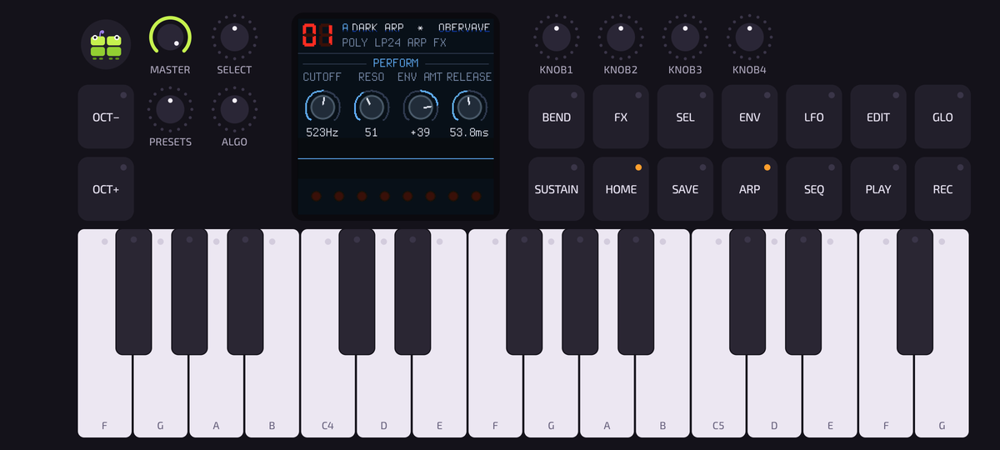
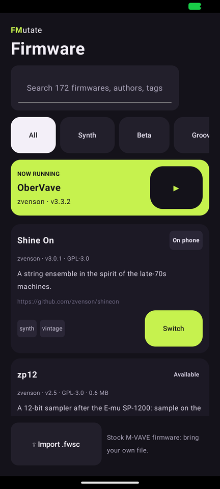
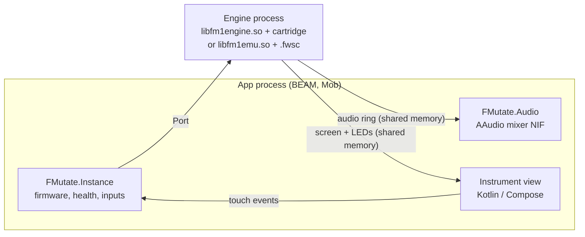

# FMutate

FMutate runs the community firmwares of the **M-VAVE FM-1** pocket synthesizer on an Android phone, and lets you
rearrange the instrument around them. The firmware is the real thing (its own code, screen, sounds and saves);
the panel is yours: a classic FM-1 layout to start, then any arrangement of keys, knobs, pads, sliders and pages
you like.

It is built with [Mob](https://github.com/GenericJam/mob) (Elixir on the phone, native Compose views), and it is
early: Android only, installed from source.

<p align="center">
  
  &nbsp;
  
</p>

## What it does

- **Runs FM-1 firmwares** in two ways:
  - **Native cartridges**: firmwares built from source for the phone, fast and sample-exact. This build ships
    [OberVave](https://github.com/zvenson/obervave) 3.3.2 and [Shine On](https://github.com/zvenson/shineon) 3.0.1.
  - **The emulator**: any firmware's own update package (`.fwsc`) runs in
    [fm1-emu](https://github.com/joakimeriksson/fm1-emu), including binary-only ones.
- **A firmware library**: the [FM-1 Firmware Hub](https://thefirmwarehub.com/) catalogue (download, check,
  delete), import of your own `.fwsc` files (stock M-VAVE firmware is bring-your-own), one-tap switching with
  undo. A firmware that crashes twice in a minute is quarantined until you choose "Run anyway".
- **A playable surface**: multitouch where every finger owns the control it touched, glissando, knobs that never
  jump, fine mode, a firmware screen drawn as large as it fits and kept sharp.
  - **Velocity** from where you strike a key (front loud, back soft).
  - **Note level**: with FMutate's OberVave, a held note's volume follows your finger on the key.
  - **Bend** a held note by sliding sideways, and a long-release **sustain**.
- **Your own layouts**, edited in place: drag, resize, add controls, pages, bindings to firmware inputs, MIDI notes
  and CCs, portrait or landscape. Saved per firmware.
- **I/O**: low-latency audio (AAudio), a virtual MIDI port `FMutate A`, USB and Bluetooth MIDI devices, MIDI clock
  in and out.
- **Sibling apps** (planned separately: a pattern sequencer, voice control, …) drive FMutate over Erlang
  distribution, after you allow them ([docs/design/protocol.md](docs/design/protocol.md)).

Tested on a Moto G Power 2021 (Android 11), a Moto G Power 5G 2024 and Android 17 emulators.

## How it works



Each firmware runs in its own OS process, so a crash, a hang or an exit ends only that process; the instance
restarts it. Audio and the screen never pass through the BEAM: the engine writes shared memory that the mixer and
the view read directly. Details: [docs/architecture.md](docs/architecture.md) and
[docs/engine_protocol.md](docs/engine_protocol.md). The design (screens, layout model, touch rules, the Opling
creature) is in [docs/design/](docs/design/HANDOFF.md).

## Installing

Download `fmutate-<version>.apk` from the [latest release](https://github.com/GenericJam/fmutate/releases/latest)
and open it on the phone (allow installs from your browser or file manager when Android asks), or from a computer:
`adb install fmutate-<version>.apk`.

- Android 9 or newer; arm64 phones (most), 32-bit ARM, and x86-64. On 32-bit ARM the built-in firmwares play,
  but downloaded ones don't (the emulator needs 64-bit).
- Releases are signed with FMutate's release key, so a later release installs over an earlier one and keeps your
  layouts and saves. A copy built from source is signed with your own debug key: Android won't install a release
  over it (or the other way round) until the other is uninstalled, which deletes its data.
- Downloaded firmwares come from the [FM-1 Firmware Hub](https://thefirmwarehub.com/), so the Library needs the
  internet; the instrument itself doesn't.

## Building

You need Linux or macOS with:

- [mise](https://mise.jdx.dev) (it installs the pinned Erlang 29, Elixir 1.20, Java 17, Zig 0.17 and Rust from
  `.tool-versions`: `mise install`)
- the Android SDK with NDK 27.2 (`~/Android/Sdk/ndk/27.2.12479018`, or set `ANDROID_NDK_HOME`) and `adb`
- a phone with USB debugging on, or an emulator

```sh
mise install
mise exec -- mix deps.get
mise exec -- rustup target add aarch64-linux-android x86_64-linux-android

# native parts: the engine and cartridges per ABI, the same for this computer (tests), the emulator engine
sh native/build_android.sh
sh native/build_host.sh
mise exec -- sh native/build_emu.sh

mise exec -- mix test

# build, install and start on a device (serial from `adb devices`)
mise exec -- mix mob.deploy --native --android --device <serial>
```

The firmware sources and fm1-emu are fetched at pinned commits into `native/build/` (git-ignored), with
FMutate's patches from `native/patches/` applied.

## Repository

| Path | What |
|---|---|
| `lib/fmutate/` | the app: instances, engines, audio, library, layouts and editor, MIDI, distribution, screens |
| `android/app/src/main/java/com/example/fmutate_app/fmutate/` | the native instrument surface (Compose), edit mode, the Opling, MIDI and I/O bridges |
| `c_src/` | the AAudio mixer and I/O NIFs |
| `native/engine/` | the engine executable and cartridge harness (C) |
| `native/emu/` | the emulator engine around fm1-emu (Rust) |
| `native/patches/` | FMutate's patches to the firmwares it builds (OberVave) |
| `priv/layouts/` | the preset layouts; `priv/layout.schema.json` is their format |
| `docs/` | architecture, engine protocol, design handoff |
| `tools/` | `rpc.exs` (evaluate Elixir in the running app), a sibling-app probe, MIDI latency measurement |

Working on the code (with or without an AI agent): [AGENTS.md](AGENTS.md).

## Licence and credits

FMutate is licensed under the **GNU GPL v3** ([LICENSE](LICENSE)): it compiles in GPL-3 firmwares.

- [OberVave](https://github.com/zvenson/obervave) and [Shine On](https://github.com/zvenson/shineon) by zvenson
  (GPL-3.0); FMutate patches OberVave to take MIDI polyphonic aftertouch as a note's level.
- [fm1-emu](https://github.com/joakimeriksson/fm1-emu) by Joakim Eriksson (MIT).
- The firmware catalogue comes from the [FM-1 Firmware Hub](https://thefirmwarehub.com/) (CC BY 4.0). Every
  firmware belongs to its author and is downloaded from where they publish it.

FMutate is not affiliated with or endorsed by M-VAVE. "FM-1" names the hardware the firmwares are written for.
