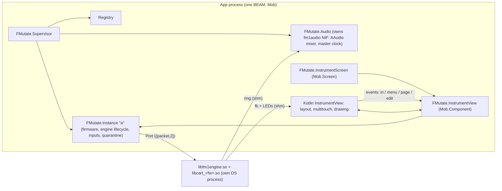

# FMutate architecture

FMutate runs M-VAVE FM-1 community firmwares on Android with a customisable instrument surface. Design:
`docs/design/HANDOFF.md` (+ boards, layouts, `protocol.md`, `creature.md`, `style.ex`). Tech spec: this file
and `docs/engine_protocol.md`; where they disagree with the design on *how*, the tech spec wins.

## Processes

- **Engines** are separate OS processes (`libfm1engine.so`, a PIE executable shipped as `lib*.so` so Android
  extracts it to the native lib dir). A crash, hang or exit ends only that process; `FMutate.Instance`
  restarts it, and quarantines a firmware that dies twice within a minute.
- **Audio** never passes through the BEAM: engines write a shared ring, `c_src/fm1audio.c` (static NIF) mixes
  the rings in an AAudio callback, resampling 44.1 kHz to the device rate.
- **The firmware screen and LEDs** never pass through the BEAM either: the Kotlin view maps `<prefix>.fb`.
- **Touch** is handled natively (per-pointer, glissando, knobs, fine mode); the view sends compact input events
  that `FMutate.InstrumentView` turns into `FMutate.Instance.input/2` calls — the same API sibling apps use
  over distribution (`docs/design/protocol.md`).

## Code map

| Path | What |
|---|---|
| `native/engine/fm1engine.c`, `live.c` | the engine executable and the cartridge harness (from `../fmutate_spike`) |
| `native/build_android.sh`, `build_host.sh` | build engine + cartridges per ABI (jniLibs) / for this computer (tests) |
| `c_src/fm1audio.c` | AAudio mixer NIF (`FMutate.AudioNif`) |
| `lib/fmutate/` | the app: `instance.ex`, `engine.ex`, `engine/wire.ex`, `audio.ex`, `firmware.ex`, `layouts.ex`, `inputs.ex`, `paths.ex`, screens |
| `android/app/src/main/java/com/example/fmutate_app/fmutate/` | native views: `InstrumentView.kt`, `Layout.kt`, `FirmwareShm.kt`, `FMutateViews.kt` |
| `priv/layouts/*.layout.json`, `priv/layout.schema.json` | layout presets and schema |
| `tools/rpc.exs` | evaluate Elixir on a device's running app |

## Decisions (tech)

- **Package id** `com.genericjam.fmutate` (Kotlin namespace stays `com.example.fmutate_app`: the JNI symbols
  in `beam_jni.c` follow it).
- **Layout fitting** (`Layout.kt` `fit/4`): authoring grid as is when it matches; else keep the authoring grid
  with smaller cells if they stay ≥ 40 dp; else move cells onto the device grid and show "doesn't fit".
- **Immersive** while the instrument shows; orientation locked to the layout's frame.
- **Engine ring fill** = max(1024, 2 × device burst + 512) frames (`FMutate.Audio.engine_fill/0`).
- **Firmware inputs**: FM-1 keys have no velocity; velocity-sensitive bindings send MIDI notes.

## Measured (Moto G Power 2021, SD662, Android 11)

| What | Value |
|---|---|
| Output | 48 kHz shared, burst 240, buffer 480, ~36 ms output latency |
| OberVave engine CPU (3-note chord) | 16–34 % of one core |
| UI frames while playing | median 11 ms, 90th 36 ms (after moving the firmware screen to its own layer) |

## I/O (HANDOFF §10)

| Module | What |
|---|---|
| `FMutate.IO` + `fmutate/FMutateIO.kt` | Android's audio outputs, MIDI devices, Bluetooth MIDI scan, the virtual ports' clients (one per app) |
| `c_src/fm1io.c` (`FMutate.IONif`) | JNI bridge: Kotlin → BEAM MIDI by `enif_send` (no JSON), state as JSON events; BEAM → Kotlin JSON calls and MIDI out |
| `FMutate.MIDI` (+ `FMutate.MIDI.Map`) | per instance: MIDI in → instance inputs (channel filter, notes → keys, bend if `caps.pitch_bend`), clock follow/send/off |
| `fmutate/FMutateMidiService.kt` | the virtual port `FMutate A` (in + out), `res/xml/fmutate_midi_a.xml` |
| `FMutate.Dist`, `FMutate.Remote`, `fmutate/FMutateSiblingProvider.kt` | distribution for sibling apps (`docs/design/protocol.md` §7) |

- **Audio route**: the AAudio stream's device id (`FMutate.Audio.stats/0` `device_id`) named through
  `AudioManager`. **Latency shown** = device output latency + the engine's ring fill (what a key press waits).
- **Virtual line-in**: reserved (`FMutate.IO` state `line_in: nil`); nothing produces it.
- **Clock send** stamps each tick with its exact `System.nanoTime` time (sent ~4 ms early), so receivers that
  honour timestamps get none of the BEAM timer's jitter. Tempo is a setting (default 120 BPM).

### MIDI latency (emulator-5558, Android 17 x86_64; `tools/midi_latency.exs`, 40 notes from a second app)

| Hop | median | p90 | max |
|---|---|---|---|
| sender → Kotlin (Android MIDI service) | 0.19 ms | 0.49 ms | 1.96 ms |
| Kotlin → BEAM (JNI, `enif_send`) | 0.10 ms | 0.22 ms | 2.18 ms |
| BEAM → engine Port (`FMutate.MIDI` → `Instance` → `Engine`) | 0.09 ms | 0.13 ms | 0.18 ms |
| total | 0.42 ms | 1.76 ms | 2.55 ms |

Decision: MIDI goes Kotlin → BEAM → Port. Its cost is well under the engine's 256-frame block (5.8 ms, the
granularity at which the firmware hears MIDI) and two orders under the output latency; a native shortcut
into the engine would save ~0.2 ms. Clock out measured 20.833 ms per tick at 120 BPM by timestamp.
