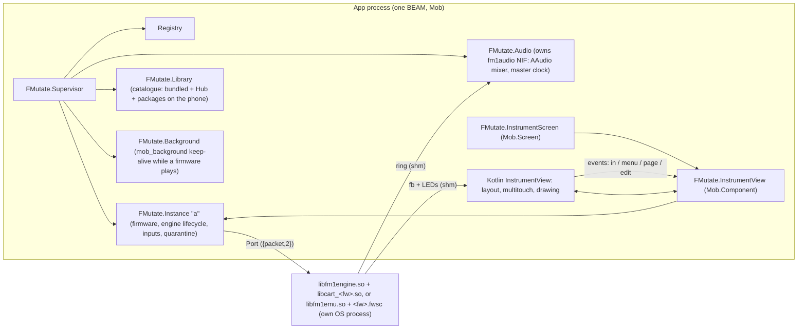

# FMutate architecture

FMutate runs M-VAVE FM-1 community firmwares on Android with a customisable instrument surface. Design:
`docs/design/HANDOFF.md` (+ boards, layouts, `protocol.md`, `creature.md`, `style.ex`). Tech spec: this file
and `docs/engine_protocol.md`; where they disagree with the design on *how*, the tech spec wins.

## Processes

- **Engines** are separate OS processes (`libfm1engine.so`, a PIE executable shipped as `lib*.so` so Android
  extracts it to the native lib dir). A crash, hang or exit ends only that process; `FMutate.Instance`
  restarts it, and quarantines a firmware that dies twice within a minute. `libfm1emu.so` is the same
  protocol around fm1-emu, for any firmware's update package (`backend: :emu`, `docs/engine_protocol.md`).
- **Audio** never passes through the BEAM: engines write a shared ring, `c_src/fm1audio.c` (static NIF) mixes
  the rings in an AAudio callback, resampling 44.1 kHz to the device rate.
- **The firmware screen and LEDs** never pass through the BEAM either: the Kotlin view maps `<prefix>.fb`.
- **Touch** is handled natively (per-pointer, glissando, knobs, fine mode); the view sends compact input events
  that `FMutate.InstrumentView` turns into `FMutate.Instance.input/2` calls — the same API sibling apps use
  over distribution (`docs/design/protocol.md`).
- **Library** (`FMutate.Library`, `library/catalog.ex`): the Hub's `catalog.json` (thefirmwarehub.com) is fetched
  with `:httpc`/`:ssl` (CA certs from `/system/etc/security/cacerts`), cached as `<data>/hub_catalog.json`, read
  at most once a day (the Hub's terms; the screen says "Checked today · next check after HH:MM" instead of
  checking again), and merged with the bundled cartridges and the packages in `<data>/packages` (Hub downloads
  as `<id>-<version>.fwsc`, imports under `imported/` as `imported:<file>`). A native cartridge keeps its id;
  the Hub's package of the same firmware stays listed as `hub:<id>` ("OberVave (Hub package)") so the two can
  be compared. Downloads are kept only when size, SHA-256 and the `.fwsc` header (`FMutate.Fwsc`) check out.
  A package "doesn't run here yet" while the build has no `libfm1emu.so`; with it, a package on the phone is
  "On phone" and runs (`FMutate.Firmware.runnable/1` → `%{engine, file, backend}`).
- **Flash per backend**: `flash/<instance>/<id>.bin` (native image) and `flash/<instance>/emu/<id>.bin`
  (fm1-emu's changed sectors), so no id shares a flash file across backends.
- **Subscriptions survive restarts**: the screens subscribe through `FMutate.Subscription`, which monitors the
  server (Instance, Library, IO, Dist) and subscribes again when its supervisor has restarted it.

## Code map

| Path | What |
|---|---|
| `native/engine/fm1engine.c`, `live.c` | the engine executable and the cartridge harness (from `../fmutate_spike`) |
| `native/build_android.sh`, `build_host.sh` | build engine + cartridges per ABI (jniLibs) / for this computer (tests) |
| `native/emu/`, `native/build_emu.sh` | the emulator engine (Rust, around fm1-emu pinned in the script; local changes to fm1-emu would go in `native/patches/fm1-emu/`, none at present) for arm64-v8a, x86_64 and this computer |
| `c_src/fm1audio.c` | AAudio mixer NIF (`FMutate.AudioNif`) |
| `lib/fmutate/` | the app: `instance.ex` (+ `instance/health.ex`: speed, too slow, auto fill, the emulated CPU clock), `engine.ex`, `engine/wire.ex`, `audio.ex`, `firmware.ex`, `library.ex`, `library/`, `fwsc.ex`, `layouts.ex`, `inputs.ex`, `paths.ex`, `subscription.ex` (screens' resubscribing helper), `background.ex` (keep-alive while a firmware plays), screens |
| `android/app/src/main/java/com/example/fmutate_app/fmutate/` | native views: `InstrumentView.kt`, `Layout.kt`, `FirmwareShm.kt`, `Opling.kt` (the creature menu button), `FMutateViews.kt` |
| `android/app/src/main/res/{drawable,mipmap-*}/ic_launcher*` | app icon: adaptive layers (vector foreground + monochrome, violet background) exported from `docs/design/boards/Main.dc.html` |
| `priv/layouts/*.layout.json`, `priv/layout.schema.json` | layout presets and schema |
| `tools/rpc.exs` | evaluate Elixir on a device's running app |

## Decisions (tech)

- **Package id** `com.genericjam.fmutate` (Kotlin namespace stays `com.example.fmutate_app`: the JNI symbols
  in `beam_jni.c` follow it).
- **Layout fitting** (`Layout.kt` `fit/4`): authoring grid as is when it matches; else keep the authoring grid
  with smaller cells if they stay ≥ 40 dp; else move cells onto the device grid and show "doesn't fit".
- **Immersive** while the instrument shows; orientation locked to the layout's frame.
- **Engine ring fill** = max(1024, 2 × device burst + 512) frames (`FMutate.Audio.engine_fill/0`) to start with; on
  the I/O buffer's Auto it rises while the slot underruns and settles back after a quiet minute, or it is a fixed
  2048 / 3072 / 3840 (`FMutate.Instance.set_buffer/2`), set on the running engine (`docs/engine_protocol.md`
  "Speed and fill").
- **System states** (booting, crashed/restarting, safe mode, too slow) show as the Opling's mood plus a short
  message in the firmware screen area ("Starting…", "Restarting…", "Crashed twice · Run anyway" — a tap on the
  screen is Run anyway —, "Too slow · N % speed" over the bottom of a running screen with what is being done or
  can be: "Slowing the emulated CPU · N MHz…", "Lower the emulated CPU in I/O", "This phone can't run it in real
  time"; "Audio dropouts · Raise the buffer in I/O" only for an engine fast enough on a fixed buffer that
  underruns); controls stay. A layout without a screen has the mood only. Too slow is the instance's call
  (`FMutate.Instance.Health`: < 95 % for 3 s on, ≥ 98 % for 3 s off); the I/O card and sibling apps' `{:slow, pct}`
  read the same view.
- **Emulated CPU clock** (emulator engine): a firmware slower than real time on a phone is cured by fewer emulated
  instructions, not by a buffer (measured below: OberVave's package underran alike at 1024 and 3840 frames). The
  engine stalls the emulated CPU below the FM-1's 240 MHz at runtime (op `0x08`, `docs/engine_protocol.md` "The
  CPU clock"; no fm1-emu change, no restart, the firmware's time and audio stay right). The instance steps it
  240 → 180 → 120 → 80 MHz while the engine is too slow, steps back up when the firmware's own audio starves (DMA
  halves it didn't refill: OberVave's package does at 80 MHz, silent at 60), keeps what worked per firmware and
  tries one step up after a quiet minute with CPU to spare. I/O shows the clock and offers Auto / 240 / 180 / 120
  / 80 MHz. Native cartridges have no such knob: too slow there is "This phone can't run it in real time".
- **Root background**: the theme background is the flat skin's `bg` (`Mob.Theme.set/1` in `FmutateApp.App`), so
  the strips Mob insets a screen by (display cutout, hidden bars) match the instrument.
- **Firmware screen size** (overrides HANDOFF §7's whole multiples, at the player's request: on a small phone a
  whole multiple leaves the screen at 1×): a screen control fills its cells by default, the largest square inside
  the bezel, drawn sharp (nearest-neighbour up to the next whole multiple, then bilinear down: `ScreenScaler` in
  `FirmwareShm.kt`), so firmware pixels stay square and even. `screen.scale` 1–4 in a layout asks for pixel-exact
  whole multiples instead (Edit → screen → Size). The classic layout gives the screen 4×3 cells: 310 px (1.29×)
  on the Moto G Power instead of 240.
- **Velocity** (replaces "keys carry no velocity"): FM-1 firmwares play key presses at a fixed velocity (OberVave's
  FM-1 build: `KEY_VEL(k)` = 100) but honour MIDI note velocity. A keyboard strip's `velocity.source` is `fixed`
  (default: firmware key presses, as the hardware) or `position`: MIDI notes (FM-1 key 0 = F3 = MIDI 53) at a
  velocity from where the key is struck (front edge = `max`, back = `min`, linear). Such a strip keeps its own
  octave (±2, a badge on the strip when not 0), moved by OCT−/OCT+ presses, which still reach the firmware; the
  firmware's own octave (its OCT LEDs) only applies to key presses. While a firmware function button is held,
  the strip sends key presses again so the firmware's key layers (SAVE + key, …) work. Measured on the Moto G
  Power 5G 2024 with OberVave: front edge peak ~13–14k, back edge ~7.5–8k (VEL>AMP 60). **Swell** (`velocity.swell`,
  opt-in, off by default since a note's velocity is fixed at note-on and the only after-strike control is global): sliding a held key front/back sends CC7 (the firmware's volume, so every
  sounding note swells together) on the same front = max, back = min scale; measured CC7 35 → 125 → 31 in one
  hold. The volume stays where the last finger left it until the next strike; leaving the layout sets 127.
- **Note level** (`velocity.pressure`, opt-in, firmwares with `caps.note_pressure`): the held note's own level
  follows the finger, MIDI polyphonic aftertouch `0xA0 note level`, level = 127 × where the finger is on the key
  (front edge 127, back edge 0), sent at the strike and on every change; it takes precedence over swell. Only
  FMutate's OberVave takes it: `native/patches/obervave/poly-aftertouch.patch` (a pressure event through the
  firmware's note queue, after the note-on; each voice of that note and sound keeps the level, multiplied into its
  amp every block on a square law, 127 = as played). Not in the Hub package of OberVave (it runs unpatched).
  Survey of 24 other firmwares (most are Felucca forks with the same per-block `env × v->vel` amp): a ~10-line
  change in most; Clipper and Frasil already take 0xA0.
- **Sustain** (classic SUSTAIN toggle): CC64 would hold notes at the patch's sustain level forever (OberVave's
  factory patches sustain at 100), so the toggle is a long release instead: CC72 (the standard release time,
  OberVave's and ShineOn's amp RELEASE) to 108 (~2.3 s) while on, so let-go notes fall away on the firmware's own
  curve and held notes are untouched; off sends 60 (OberVave's factory release), or the value a control of the
  layout last set for CC72. It changes the patch's release while on. Measured: tail 6205 → 347 over 2.4 s with
  it, 1465 → 30 without. A CC button binding sends `on` (default 127) while pressed / toggled on and `off`
  (default 0) on release; toggled bindings are sent again when a new engine starts and released when the layout
  goes away.
- **Bend** (classic BEND toggle, binding target `{"action": "bend"}`; or a strip's glide = wobble): sideways
  slide on a held key sends pitch bend instead of playing the next key; half a key width is the strip's
  `bend_range` (a quarter tone by default, 1 or 2 semitones), scaled on the assumption that the firmware's own
  bend range is ±2 semitones (every OberVave/ShineOn factory program). Only changes are sent; release recentres.
- **Octave in step**: with a strike-velocity strip, 2 s after a new engine runs (its firmware's own boot) the surface
  presses OCT− and OCT+ together and sets the strip's octave to 0, where the firmware sets its octave to 0 that way
  (`caps.octave_reset_both`: OberVave, ShineOn). Toggles (SUSTAIN, BEND) are sent again at the same moment.
- **Background** (`FMutate.Background`, the `mob_background` plugin pinned by git ref): while any instance has an
  engine (phase `:booting`, `:running`, or `:crashed` until its restart) the app holds a `mediaPlayback` foreground
  service with the notification "FMutate is playing"; safe mode or a firmware that can't run here lets it go (the
  notification goes, Android may freeze the app). Tied to the engine, not to MIDI clients or sibling apps: they
  only matter while a firmware plays, and the type has to match what the user hears. `mediaPlayback`, not the
  plugin's default `dataSync` (Android 15 caps that at 6 h a day in the background): the `<service>` is declared
  in our `AndroidManifest.xml` with that type and `FOREGROUND_SERVICE_MEDIA_PLAYBACK`, and the build leaves it.
  Android starts a foreground service only from the foreground; a refused start is retried when the app comes
  back. The first start asks for `POST_NOTIFICATIONS` (Android 13+ hides the notification without it; the service
  runs either way).

## Inputs: what can lose a press, and how to see it

| Where | What went wrong | Now |
|---|---|---|
| Engines | A press and its release in one batch of port messages were applied before the firmware scanned its keys (keys always; buttons on a double tap; everything in the emulator, worst when it runs slow) | Each key/button edge is queued and spaced 16 ms of firmware time (`docs/engine_protocol.md` "Panel edges") |
| Surface | A finger whose lift Android never delivered (a cancelled gesture, a sheet or another screen over the instrument) kept its key/button held, and a held function button is a firmware layer: other buttons then do other jobs | One pointer loop for the surface's lifetime; every event checks that each grabbed finger is still down and lets go of those that aren't; leaving the surface lets go of everything. Each such release is reported |
| Instance | Inputs while no engine is ready (booting, restarting) are dropped | Unchanged (the new engine starts with nothing held), but journaled |

When something seems stuck: I/O → Developer shows what the firmware holds now, the surface's last reports
("stale_fingers"), and **Release all** (up for every held key and button, MIDI all notes off, pitch bend centred,
volume full). From a computer: `mise exec -- mix run --no-start tools/rpc.exs <serial> 'FMutate.Instance.journal("a", 50)'`
lists the last inputs, newest first, as `{ms, kind, event, :sent | :dropped | :noted}` (kinds `:in`, `:surface`,
`:engine`), and `FMutate.Instance.held("a")` the held keys and buttons.

## Measured (Moto G Power 2021, SD662, Android 11)

| What | Value |
|---|---|
| Output | 48 kHz shared, burst 240, buffer 480, ~36 ms output latency |
| OberVave engine CPU (3-note chord) | 16–34 % of one core |
| UI frames, 6 × 300 ms key holds (`gfxinfo reset`, 6 × `input swipe 1100 600 1100 600 300`), firmware screen animating, debug build | before: 24 % / 17 % / 15 % janky, p50 10–12 ms, p90 24–25 ms, p99 32–53 ms; after: 8.4 % / 4.5 % / 4.4 % janky, p50 6–7 ms, p90 11–13 ms, p99 26–40 ms |
| Audio underruns over those 3 runs | before 2 → 7; after 1 → 1 (no xruns either way) |
| Same, after the system states (master 2b354af + `states`: health per STATUS, screen-area messages, Opling breath) | 0 % / 0 % / 0 % janky (180 / 169 / 171 frames), p50 5–6 ms, p90 7–8 ms, p99 9–10 ms; underruns 172 → 172, no xruns |
| OberVave's package on `libfm1emu.so` (the emulator engine) | speed 81–84 %, too slow from the 6th second; auto fill 1024 → 3840 in 10 s; underruns ~66/s at 1024 and ~60/s at 3840 (47 → 123 in s 1–4; 791 → 3481 in s 15–60): more fill can't make up a slower-than-real-time engine, as expected |
| Merged master d0e1e64 (all streams), same procedure | 0.6 % / 0 % / 0 % janky, p90 7–8 ms, p99 12–13 ms |
| With Mob PR [#236](https://github.com/GenericJam/mob/pull/236) (no repaint when a component's render is unchanged), pinned to its commit for the test | 0.6 % / 0 % / 0 % janky, p90 7–8 ms, p99 8–10 ms; touch still reaches the firmware (peak 4975). Before it, each input event made Mob commit the screen twice (10–20 ms of UI-thread recomposition per commit). Released in mob 0.9.28; FMutate uses `~> 0.9.29` |
| Classic rearranged, screen filled and sharp-scaled (310 px, ×2 prescale per frame) | 2.5 % / 0 % / 0 % janky, p90 10–11 ms, p99 13–19 ms |

### Emulated CPU clock (emulator engine)

| Where | What |
|---|---|
| x86-64 desktop, `--bench`, OberVave's package, 3-note chord (JIT) | 240 MHz 3.7x real time, 180 4.0x, 120 4.8–5.1x, 80 7.1x; stale DMA halves: none at 240–120, ~43/s at 80 (audio peak unchanged: 3971 / 3937); silent at 60 |
| Same, interpreted (`FM1_NO_JIT=1`) | Dinghy 0.65x at 240, 1.32x at 120, 1.8x at 80; OberVave's package 0.98x / 1.51x / 2.04x (74 stale halves in 3 s at 80) |
| emulator-5554 (Android 17 x86_64), OberVave's package interpreted (`emu_env` `FM1_NO_JIT=1`), chord held, Auto | 240 MHz at 44 % speed → 180 (3 s after "too slow") → 120 at 61 % → 80 at 81 %, where its audio starved → back to 120 (its floor), 78–87 %: "This phone can't run it in real time". Restarted with the JIT at the kept clock (180), 100 %; after 61 s one step up to 240, 100 %. Fixed 180 in I/O: "Lower the emulated CPU in I/O" |
| Moto G Power 5G 2024 (arm64), `libfm1emu.so --bench`, 8 s, keys 7 11 14 held, 240 MHz | OberVave 1.91x, Dinghy 2.85x, AMB 1.77x, ZEN 1.91x, GR!MM 2.07x, Mutable 1.96x, FMini 2.58x, Felucca 1.54x, Sloop 1.33x, JIANT 1.22x, Frasil 1.22x, Skiff 1.01x, Clipper 1.00x, **Melodee 0.68x** (148 % of a core: it runs both CPU cores) |
| Same, the slow ones at lower clocks | Melodee 0.76x / 0.86x / 0.96x at 180 / 120 / 80 (never real time: its second core's work isn't helped much); Clipper 1.10x / 1.22x / 1.24x; Skiff 1.20x / 1.66x / 2.35x, but **silent at 80 with no stale halves** (starving that the stale-half check misses; Auto only reaches 80 when 120 is too slow) |
| Same phone, in the app, chord held, Auto | Skiff: 87 % at 240 → 180 MHz, 100 % from then on, no new underruns. Melodee: 75 % at 180 → 80 MHz, 83–95 %: "Too slow · 94 % speed / This phone can't run it in real time". OberVave's package: 101 % at 240, no change. (Melodee's "Setup unfinished / Factory sounds missing" is its own first-boot screen: its web installer adds the factory sounds; OCT+ continues without them.) |
| Same phone, gfxinfo with native OberVave (6 × 300 ms key holds, 3 runs; the display runs at 120 Hz, so the budget is 8.3 ms) | mob 0.9.27: 8.0 % / 3.7 % / 3.7 % janky, p90 15–18 ms, p99 20–23 ms. mob 0.9.29 (with #236, no repaint on unchanged renders): 0.7 % / 0 % / 1.3 % janky, p90 13–14 ms, p99 15–17 ms |

### Background (emulator-5560, Android 17 x86_64, OberVave)

HOME, then `input keyevent KEYCODE_SLEEP` (screen off, `mWakefulness=Asleep`) for 5 minutes. A sampler on the
device recorded `FMutate.Audio.stats/0` every ~5 s (frames, the window's peak); `dumpsys activity processes` and
`get-standby-bucket` every 30 s; at 5 min `tools/android_probe` played note 60 for 2 s into `FMutate A`.

| | keep-alive on | keep-alive off (`Background` stopped, `MobBackground.stop()`) |
|---|---|---|
| process | procstate 4 (foreground service), adj 50 → 200, never frozen; `dumpsys activity services`: `isForeground=true types=0x00000002` (mediaPlayback) | procstate 15 (cached), adj 700 → 900, `isFrozen=true` from ~70–90 s on |
| audio frames | 44.0–44.3 k per s (44.1 kHz) for all 308 s, no sample gap over 5.07 s | real time for 70 s, then one 236.7 s gap: nothing ran until the probe's MIDI connection thawed the app |
| engine | the same engine all along | thawed, the watchdog saw it as hung and killed and restarted it |
| the MIDI note | journaled `:sent`, peak 7851 in its window | journaled `:sent` to the just-restarted engine (still booting its firmware), peak 0: not heard |
| distribution | `tools/rpc.exs` answered with the screen off | answered only after the thaw |
| standby bucket | 10 (active) | 10 |

The notification shows in the shade as "FMutate · FMutate is playing" (silent section). Safe mode (two `kill9`
within a minute) turns the keep-alive off and removes the notification; Run anyway turns it on again.

### Library list (emulator-5556, Android 17 x86_64, debug build, 199–201 cards)

The list is a `<LazyList>` between the fixed header and footer: only the cards on screen are composed (each
row carries its own padding; the list's id follows the search and tag so a new filter starts at the top).
`dumpsys gfxinfo` after `reset`, 3 runs each: open = tap Library from the instrument (includes the rotation to
portrait), scroll = 5 × `input swipe 540 1900 540 600 250`.

| | before (eager `Scroll`) | after (`LazyList`) |
|---|---|---|
| open: Davey frames | 2499 / 2649 / 1383 + 1426 ms | none |
| open: p90 / p99 | 42–1400 / 1400–2600 ms | 65–117 / 150–200 ms |
| scroll: janky, p50 / p90 / p99 | 14–23 %, 30–32 / 42–48 / 61–81 ms | 16–17 %, 16–18 / 27–31 / 32–44 ms |

## I/O (HANDOFF §10)

| Module | What |
|---|---|
| `FMutate.IO` | MIDI devices (list, hot-plug, open/close, reopen by name), Bluetooth MIDI scan/connect, the virtual ports' clients, audio outputs (one per app) |
| mob_midi plugin (`MobMidi`, `mob.exs` `:plugins`) | Android MIDI: devices, ports, timestamped bytes in by `enif_send` to the process that opened the port, timestamped sends, hot-plug, BLE-MIDI central, the virtual port's service (`io.mob.midi.MobMidiDeviceService`) |
| `fmutate/FMutateIO.kt` + `c_src/fm1io.c` (`FMutate.IONif`) | audio output devices as JSON events (mob core has no audio-device list) |
| `FMutate.MIDI` (+ `FMutate.MIDI.Map`) | per instance: opens its virtual port and (instance `"a"`, IO's player) the devices IO asks for; MIDI in → instance inputs (channel filter, notes → keys, bend if `caps.pitch_bend`), clock follow/send/off |
| `AndroidManifest.xml` service + `res/xml/fmutate_midi_a.xml` | the virtual port `FMutate A` (in + out): Android reads a MIDI service's name and ports from the app's manifest, so it is declared here, with mob_midi's class |
| `FMutate.Dist`, `FMutate.Remote`, `fmutate/FMutateSiblingProvider.kt` | distribution for sibling apps (`docs/design/protocol.md` §7) |

- **Audio route**: the AAudio stream's device id (`FMutate.Audio.stats/0` `device_id`) named through
  `AudioManager`. **Latency shown** = device output latency + the engine's ring fill (what a key press waits).
- **Virtual line-in**: reserved (`FMutate.IO` state `line_in: nil`); nothing produces it.
- **Clock send** stamps each tick with its exact `MobMidi.now_ns/0` (`System.nanoTime`) time (sent ~4 ms early,
  `MobMidi.send_raw/4` `at:`), so receivers that honour timestamps get none of the BEAM timer's jitter. Tempo
  is a setting (default 120 BPM).
- **Bluetooth**: "Scan Bluetooth" asks for the `:midi_bluetooth` permission (`Mob.Permissions`) the first time
  the scan is refused; a connected device then lists and opens like a USB one.

### MIDI latency (`tools/midi_latency.exs`, notes from a second app into `FMutate A`)

emulator-5556 (Android 17 x86_64), median / p90 / max in ms. "Kotlin" is the MIDI bridge's receiver: FMutate's own
`FMutateIO.kt` + `fm1io.c` before, mob_midi's `MobMidiBridge` + zig NIF after (bytes, port and both timestamps in
one `enif_send` to `FMutate.MIDI`, which opened the port).

| Hop | in-app bridge (2 runs, 40 + 100 notes) | mob_midi (3 runs, 100 + 100 + 200 notes) |
|---|---|---|
| sender → Kotlin (Android MIDI service) | 0.20 / 0.50–0.76 / 1.3–3.0 | 0.18–0.23 / 0.31–0.80 / 1.2–4.4 |
| Kotlin → BEAM (JNI, `enif_send`) | 0.08–0.10 / 0.20–0.27 / 2.0–2.6 | 0.08–0.12 / 0.19–0.26 / 0.7–4.0 |
| BEAM → engine Port (`FMutate.MIDI` → `Instance` → `Engine`) | 0.09 / 0.13–0.16 / 0.3–5.8 | 0.08–0.09 / 0.12–0.14 / 0.2–1.5 |
| total | 0.41–0.42 / 1.4–2.0 / 3.2–6.5 | 0.37–0.47 / 0.56–1.33 / 1.3–4.6 |

The move to mob_midi changed nothing measurable: the run-to-run spread on the emulator is larger than any
difference. (Earlier, emulator-5558: total 0.42 / 1.76 / 2.55 ms.)

Decision: MIDI goes Kotlin → BEAM → Port. Its cost is well under the engine's 256-frame block (5.8 ms, the
granularity at which the firmware hears MIDI) and two orders under the output latency; a native shortcut
into the engine would save ~0.2 ms. Clock out measured 20.833 ms per tick at 120 BPM by timestamp (again through mob_midi's `send_raw/4` `at:`:
min = max = 20.833 ms over 240 ticks).
