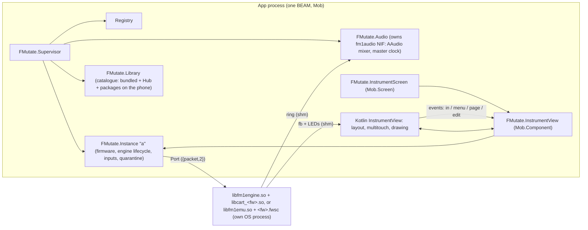

# FMutate architecture

FMutate runs M-VAVE FM-1 community firmwares on Android with a customisable instrument surface. Design:
`docs/design/HANDOFF.md` (+ boards, layouts, `protocol.md`, `creature.md`, `style.ex`). Tech spec: this file
and `docs/engine_protocol.md`; where they disagree with the design on *how*, the tech spec wins.

## Processes

- **Engines** are separate OS processes (`libfm1engine.so`, a PIE executable shipped as `lib*.so` so Android
  extracts it to the native lib dir). A crash, hang or exit ends only that process; `FMutate.Instance`
  restarts it, and quarantines a firmware that dies twice within a minute. `libfm1emu.so` is the same
  protocol around fm1-emu, for any firmware's update package (`backend: :emu`, `docs/engine_protocol.md`).
- **Audio** never passes through the BEAM: engines write a shared ring, `c_src/fm1audio.c` (static NIF) mixes
  the rings in an AAudio callback, resampling 44.1 kHz to the device rate.
- **The firmware screen and LEDs** never pass through the BEAM either: the Kotlin view maps `<prefix>.fb`.
- **Touch** is handled natively (per-pointer, glissando, knobs, fine mode); the view sends compact input events
  that `FMutate.InstrumentView` turns into `FMutate.Instance.input/2` calls — the same API sibling apps use
  over distribution (`docs/design/protocol.md`).
- **Library** (`FMutate.Library`, `library/catalog.ex`): the Hub's `catalog.json` (thefirmwarehub.com) is fetched
  with `:httpc`/`:ssl` (CA certs from `/system/etc/security/cacerts`), cached as `<data>/hub_catalog.json`, read
  at most once a day (the Hub's terms; the screen says "Checked today · next check after HH:MM" instead of
  checking again), and merged with the bundled cartridges and the packages in `<data>/packages` (Hub downloads
  as `<id>-<version>.fwsc`, imports under `imported/` as `imported:<file>`). A native cartridge keeps its id;
  the Hub's package of the same firmware stays listed as `hub:<id>` ("OberVave (Hub package)") so the two can
  be compared. Downloads are kept only when size, SHA-256 and the `.fwsc` header (`FMutate.Fwsc`) check out.
  A package "doesn't run here yet" while the build has no `libfm1emu.so`; with it, a package on the phone is
  "On phone" and runs (`FMutate.Firmware.runnable/1` → `%{engine, file, backend}`).
- **Flash per backend**: `flash/<instance>/<id>.bin` (native image) and `flash/<instance>/emu/<id>.bin`
  (fm1-emu's changed sectors), so no id shares a flash file across backends.
- **Subscriptions survive restarts**: the screens subscribe through `FMutate.Subscription`, which monitors the
  server (Instance, Library, IO, Dist) and subscribes again when its supervisor has restarted it.

## Code map

| Path | What |
|---|---|
| `native/engine/fm1engine.c`, `live.c` | the engine executable and the cartridge harness (from `../fmutate_spike`) |
| `native/build_android.sh`, `build_host.sh` | build engine + cartridges per ABI (jniLibs) / for this computer (tests) |
| `native/emu/`, `native/build_emu.sh`, `native/patches/fm1-emu/` | the emulator engine (Rust, around fm1-emu pinned in the script) for arm64-v8a, x86_64 and this computer |
| `c_src/fm1audio.c` | AAudio mixer NIF (`FMutate.AudioNif`) |
| `lib/fmutate/` | the app: `instance.ex` (+ `instance/health.ex`: speed, too slow, auto fill), `engine.ex`, `engine/wire.ex`, `audio.ex`, `firmware.ex`, `library.ex`, `library/`, `fwsc.ex`, `layouts.ex`, `inputs.ex`, `paths.ex`, `subscription.ex` (screens' resubscribing helper), screens |
| `android/app/src/main/java/com/example/fmutate_app/fmutate/` | native views: `InstrumentView.kt`, `Layout.kt`, `FirmwareShm.kt`, `Opling.kt` (the creature menu button), `FMutateViews.kt` |
| `android/app/src/main/res/{drawable,mipmap-*}/ic_launcher*` | app icon: adaptive layers (vector foreground + monochrome, violet background) exported from `docs/design/boards/Main.dc.html` |
| `priv/layouts/*.layout.json`, `priv/layout.schema.json` | layout presets and schema |
| `tools/rpc.exs` | evaluate Elixir on a device's running app |

## Decisions (tech)

- **Package id** `com.genericjam.fmutate` (Kotlin namespace stays `com.example.fmutate_app`: the JNI symbols
  in `beam_jni.c` follow it).
- **Layout fitting** (`Layout.kt` `fit/4`): authoring grid as is when it matches; else keep the authoring grid
  with smaller cells if they stay ≥ 40 dp; else move cells onto the device grid and show "doesn't fit".
- **Immersive** while the instrument shows; orientation locked to the layout's frame.
- **Engine ring fill** = max(1024, 2 × device burst + 512) frames (`FMutate.Audio.engine_fill/0`) to start with; on
  the I/O buffer's Auto it rises while the slot underruns and settles back after a quiet minute, or it is a fixed
  2048 / 3072 / 3840 (`FMutate.Instance.set_buffer/2`), set on the running engine (`docs/engine_protocol.md`
  "Speed and fill").
- **System states** (booting, crashed/restarting, safe mode, too slow) show as the Opling's mood plus a short
  message in the firmware screen area ("Starting…", "Restarting…", "Crashed twice · Run anyway" — a tap on the
  screen is Run anyway —, "Too slow · N % speed" over the bottom of a running screen with "Raise the buffer in
  I/O"); controls stay. A layout without a screen has the mood only. Too slow is the instance's call
  (`FMutate.Instance.Health`: < 95 % for 3 s on, ≥ 98 % for 3 s off); the I/O card and sibling apps' `{:slow, pct}`
  read the same view.
- **Root background**: the theme background is the flat skin's `bg` (`Mob.Theme.set/1` in `FmutateApp.App`), so
  the strips Mob insets a screen by (display cutout, hidden bars) match the instrument.
- **Firmware screen size** (overrides HANDOFF §7's whole multiples, at the player's request: on a small phone a
  whole multiple leaves the screen at 1×): a screen control fills its cells by default, the largest square inside
  the bezel, drawn sharp (nearest-neighbour up to the next whole multiple, then bilinear down: `ScreenScaler` in
  `FirmwareShm.kt`), so firmware pixels stay square and even. `screen.scale` 1–4 in a layout asks for pixel-exact
  whole multiples instead (Edit → screen → Size). The classic layout gives the screen 4×3 cells: 310 px (1.29×)
  on the Moto G Power instead of 240.
- **Firmware inputs**: FM-1 keys have no velocity; velocity-sensitive bindings send MIDI notes.

## Measured (Moto G Power 2021, SD662, Android 11)

| What | Value |
|---|---|
| Output | 48 kHz shared, burst 240, buffer 480, ~36 ms output latency |
| OberVave engine CPU (3-note chord) | 16–34 % of one core |
| UI frames, 6 × 300 ms key holds (`gfxinfo reset`, 6 × `input swipe 1100 600 1100 600 300`), firmware screen animating, debug build | before: 24 % / 17 % / 15 % janky, p50 10–12 ms, p90 24–25 ms, p99 32–53 ms; after: 8.4 % / 4.5 % / 4.4 % janky, p50 6–7 ms, p90 11–13 ms, p99 26–40 ms |
| Audio underruns over those 3 runs | before 2 → 7; after 1 → 1 (no xruns either way) |
| Same, after the system states (master 2b354af + `states`: health per STATUS, screen-area messages, Opling breath) | 0 % / 0 % / 0 % janky (180 / 169 / 171 frames), p50 5–6 ms, p90 7–8 ms, p99 9–10 ms; underruns 172 → 172, no xruns |
| OberVave's package on `libfm1emu.so` (the emulator engine) | speed 81–84 %, too slow from the 6th second; auto fill 1024 → 3840 in 10 s; underruns ~66/s at 1024 and ~60/s at 3840 (47 → 123 in s 1–4; 791 → 3481 in s 15–60): more fill can't make up a slower-than-real-time engine, as expected |
| Merged master d0e1e64 (all streams), same procedure | 0.6 % / 0 % / 0 % janky, p90 7–8 ms, p99 12–13 ms |
| With Mob PR [#236](https://github.com/GenericJam/mob/pull/236) (no repaint when a component's render is unchanged), pinned to its commit for the test | 0.6 % / 0 % / 0 % janky, p90 7–8 ms, p99 8–10 ms; touch still reaches the firmware (peak 4975). Before it, each input event made Mob commit the screen twice (10–20 ms of UI-thread recomposition per commit). Switch the `mob` dep to the release that includes #236 once published |
| Classic rearranged, screen filled and sharp-scaled (310 px, ×2 prescale per frame) | 2.5 % / 0 % / 0 % janky, p90 10–11 ms, p99 13–19 ms |

### Library list (emulator-5556, Android 17 x86_64, debug build, 199–201 cards)

The list is a `<LazyList>` between the fixed header and footer: only the cards on screen are composed (each
row carries its own padding; the list's id follows the search and tag so a new filter starts at the top).
`dumpsys gfxinfo` after `reset`, 3 runs each: open = tap Library from the instrument (includes the rotation to
portrait), scroll = 5 × `input swipe 540 1900 540 600 250`.

| | before (eager `Scroll`) | after (`LazyList`) |
|---|---|---|
| open: Davey frames | 2499 / 2649 / 1383 + 1426 ms | none |
| open: p90 / p99 | 42–1400 / 1400–2600 ms | 65–117 / 150–200 ms |
| scroll: janky, p50 / p90 / p99 | 14–23 %, 30–32 / 42–48 / 61–81 ms | 16–17 %, 16–18 / 27–31 / 32–44 ms |

## I/O (HANDOFF §10)

| Module | What |
|---|---|
| `FMutate.IO` + `fmutate/FMutateIO.kt` | Android's audio outputs, MIDI devices, Bluetooth MIDI scan, the virtual ports' clients (one per app) |
| `c_src/fm1io.c` (`FMutate.IONif`) | JNI bridge: Kotlin → BEAM MIDI by `enif_send` (no JSON), state as JSON events; BEAM → Kotlin JSON calls and MIDI out |
| `FMutate.MIDI` (+ `FMutate.MIDI.Map`) | per instance: MIDI in → instance inputs (channel filter, notes → keys, bend if `caps.pitch_bend`), clock follow/send/off |
| `fmutate/FMutateMidiService.kt` | the virtual port `FMutate A` (in + out), `res/xml/fmutate_midi_a.xml` |
| `FMutate.Dist`, `FMutate.Remote`, `fmutate/FMutateSiblingProvider.kt` | distribution for sibling apps (`docs/design/protocol.md` §7) |

- **Audio route**: the AAudio stream's device id (`FMutate.Audio.stats/0` `device_id`) named through
  `AudioManager`. **Latency shown** = device output latency + the engine's ring fill (what a key press waits).
- **Virtual line-in**: reserved (`FMutate.IO` state `line_in: nil`); nothing produces it.
- **Clock send** stamps each tick with its exact `System.nanoTime` time (sent ~4 ms early), so receivers that
  honour timestamps get none of the BEAM timer's jitter. Tempo is a setting (default 120 BPM).

### MIDI latency (emulator-5558, Android 17 x86_64; `tools/midi_latency.exs`, 40 notes from a second app)

| Hop | median | p90 | max |
|---|---|---|---|
| sender → Kotlin (Android MIDI service) | 0.19 ms | 0.49 ms | 1.96 ms |
| Kotlin → BEAM (JNI, `enif_send`) | 0.10 ms | 0.22 ms | 2.18 ms |
| BEAM → engine Port (`FMutate.MIDI` → `Instance` → `Engine`) | 0.09 ms | 0.13 ms | 0.18 ms |
| total | 0.42 ms | 1.76 ms | 2.55 ms |

Decision: MIDI goes Kotlin → BEAM → Port. Its cost is well under the engine's 256-frame block (5.8 ms, the
granularity at which the firmware hears MIDI) and two orders under the output latency; a native shortcut
into the engine would save ~0.2 ms. Clock out measured 20.833 ms per tick at 120 BPM by timestamp.
