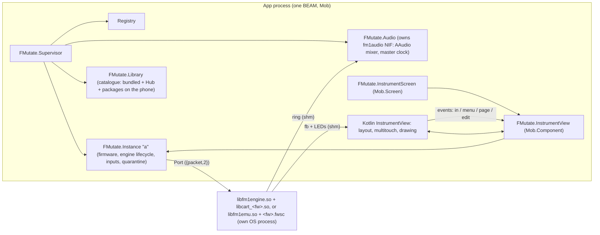

# FMutate architecture

FMutate runs M-VAVE FM-1 community firmwares on Android with a customisable instrument surface. Design:
`docs/design/HANDOFF.md` (+ boards, layouts, `protocol.md`, `creature.md`, `style.ex`). Tech spec: this file
and `docs/engine_protocol.md`; where they disagree with the design on *how*, the tech spec wins.

## Processes

- **Engines** are separate OS processes (`libfm1engine.so`, a PIE executable shipped as `lib*.so` so Android
  extracts it to the native lib dir). A crash, hang or exit ends only that process; `FMutate.Instance`
  restarts it, and quarantines a firmware that dies twice within a minute. `libfm1emu.so` is the same
  protocol around fm1-emu, for any firmware's update package (`backend: :emu`, `docs/engine_protocol.md`).
- **Audio** never passes through the BEAM: engines write a shared ring, `c_src/fm1audio.c` (static NIF) mixes
  the rings in an AAudio callback, resampling 44.1 kHz to the device rate.
- **The firmware screen and LEDs** never pass through the BEAM either: the Kotlin view maps `<prefix>.fb`.
- **Touch** is handled natively (per-pointer, glissando, knobs, fine mode); the view sends compact input events
  that `FMutate.InstrumentView` turns into `FMutate.Instance.input/2` calls — the same API sibling apps use
  over distribution (`docs/design/protocol.md`).
- **Library** (`FMutate.Library`, `library/catalog.ex`): the Hub's `catalog.json` (thefirmwarehub.com) is fetched
  with `:httpc`/`:ssl` (CA certs from `/system/etc/security/cacerts`), cached as `<data>/hub_catalog.json`, read
  at most once a day (the Hub's terms), and merged with the bundled cartridges (a native cartridge wins) and
  the packages in `<data>/packages` (Hub downloads as `<id>-<version>.fwsc`, imports under `imported/`).
  Downloads are kept only when size, SHA-256 and the `.fwsc` header (`FMutate.Fwsc`) check out. A package
  "doesn't run here yet" while the build has no `libfm1emu.so`.

## Code map

| Path | What |
|---|---|
| `native/engine/fm1engine.c`, `live.c` | the engine executable and the cartridge harness (from `../fmutate_spike`) |
| `native/build_android.sh`, `build_host.sh` | build engine + cartridges per ABI (jniLibs) / for this computer (tests) |
| `native/emu/`, `native/build_emu.sh`, `native/patches/fm1-emu/` | the emulator engine (Rust, around fm1-emu pinned in the script) for arm64-v8a, x86_64 and this computer |
| `c_src/fm1audio.c` | AAudio mixer NIF (`FMutate.AudioNif`) |
| `lib/fmutate/` | the app: `instance.ex`, `engine.ex`, `engine/wire.ex`, `audio.ex`, `firmware.ex`, `library.ex`, `library/`, `fwsc.ex`, `layouts.ex`, `inputs.ex`, `paths.ex`, screens |
| `android/app/src/main/java/com/example/fmutate_app/fmutate/` | native views: `InstrumentView.kt`, `Layout.kt`, `FirmwareShm.kt`, `FMutateViews.kt` |
| `priv/layouts/*.layout.json`, `priv/layout.schema.json` | layout presets and schema |
| `tools/rpc.exs` | evaluate Elixir on a device's running app |

## Decisions (tech)

- **Package id** `com.genericjam.fmutate` (Kotlin namespace stays `com.example.fmutate_app`: the JNI symbols
  in `beam_jni.c` follow it).
- **Layout fitting** (`Layout.kt` `fit/4`): authoring grid as is when it matches; else keep the authoring grid
  with smaller cells if they stay ≥ 40 dp; else move cells onto the device grid and show "doesn't fit".
- **Immersive** while the instrument shows; orientation locked to the layout's frame.
- **Engine ring fill** = max(1024, 2 × device burst + 512) frames (`FMutate.Audio.engine_fill/0`).
- **Firmware inputs**: FM-1 keys have no velocity; velocity-sensitive bindings send MIDI notes.

## Measured (Moto G Power 2021, SD662, Android 11)

| What | Value |
|---|---|
| Output | 48 kHz shared, burst 240, buffer 480, ~36 ms output latency |
| OberVave engine CPU (3-note chord) | 16–34 % of one core |
| UI frames while playing | median 11 ms, 90th 36 ms (after moving the firmware screen to its own layer) |
