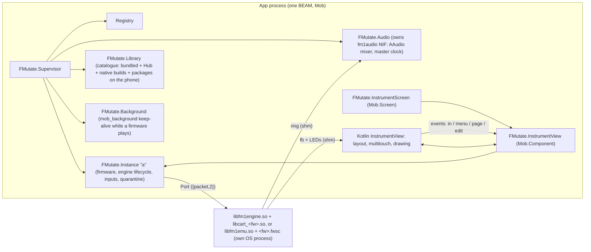

# FMutate architecture

FMutate runs M-VAVE FM-1 community firmwares on Android with a customisable instrument surface. Design:
`docs/design/HANDOFF.md` (+ boards, layouts, `protocol.md`, `creature.md`, `style.ex`). Tech spec: this file
and `docs/engine_protocol.md`; where they disagree with the design on *how*, the tech spec wins.

The iOS port (in progress, branch `ios`): engines in the app process, the emulator interpreted, RemoteIO audio,
a Swift surface; design and measurements in `docs/decisions/2026-11-13-ios-port.md`.

## Processes

- **Engines** are separate OS processes (`libfm1engine.so`, a PIE executable shipped as `lib*.so` so Android
  extracts it to the native lib dir). A crash, hang or exit ends only that process; `FMutate.Instance`
  restarts it, and quarantines a firmware that dies twice within a minute. `libfm1emu.so` is the same
  protocol around fm1-emu, for any firmware's update package (`backend: :emu`, `docs/engine_protocol.md`).
- **Audio** never passes through the BEAM: engines write a shared ring, `c_src/fm1audio.c` (static NIF) mixes
  the rings in an AAudio callback, resampling 44.1 kHz to the device rate. Each ring has its own gain (crossfades)
  and left/right balance (the instance's BALANCE, below) before the rings are summed.
- **The firmware screen and LEDs** never pass through the BEAM either: the Kotlin view maps `<prefix>.fb`.
- **Touch** is handled natively (per-pointer, glissando, knobs, fine mode); the view sends compact input events
  that `FMutate.InstrumentView` turns into `FMutate.Instance.input/2` calls — the same API sibling apps use
  over distribution (`docs/design/protocol.md`).
- **Library** (`FMutate.Library`, `library/catalog.ex`): the Hub's `catalog.json` (thefirmwarehub.com) is fetched
  with `:httpc`/`:ssl` (CA certs from `/system/etc/security/cacerts`), cached as `<data>/hub_catalog.json`, read
  at most once a day (the Hub's terms; the screen says "Checked today · next check after HH:MM" instead of
  checking again), and merged with the bundled cartridges and the packages in `<data>/packages` (Hub downloads
  as `<id>-<version>.fwsc`, imports under `imported/` as `imported:<file>`). A native cartridge keeps its id;
  the Hub's package of the same firmware stays listed as `hub:<id>` ("OberVave (Hub package)") so the two can
  be compared. Downloads are kept only when size, SHA-256 and the `.fwsc` header (`FMutate.Fwsc`) check out.
  A package "doesn't run here yet" while the build has no `libfm1emu.so`; with it, a package on the phone is
  "On phone" and runs (`FMutate.Firmware.runnable/1` → `%{engine, file, backend}`).
- **Synth pages** (`FMutate.FirmwareScreen`, opened by a tap on a library card; the card's actions are shared
  through `FMutate.LibraryUI`): a firmware's fuller description is its repository's README, read by
  `FMutate.Library.Description` when the page opens (`Mob.Socket.start_async/3`) from
  `https://raw.githubusercontent.com/<owner>/<name>/<ref>/README.md` (then `Readme.md`, `readme.md`, `README` after a 404), over
  `FMutate.Library.HTTP` with a 512 KB cap. The ref is the one the build or package comes from: a Hub package's
  verified build commit (`provenance.commit`), else `srcref`, else its release `tag`, else the default branch
  (`HEAD`); a native build's index `commit`; a bundled cartridge's commit in `native/build_android.sh` (also in
  `FMutate.Firmware`'s `@bundled`). Cached per repository and ref as `<data>/descriptions/<hash>.md` + `.term`
  (ETag, Last-Modified, when, file name). The page parses nothing in mount: the copy comes from one task, the
  conditional read (a 304 keeps the copy) from another, and the read wins. A failed read keeps the copy and says
  why: "Offline: couldn't reach GitHub.", "No README at <ref>.", "GitHub answered <status>." or "too large",
  then "Showing the copy read on <date>"; with no copy the Hub's card text (`what`, the maker's `fmhub.json`) is
  what there is. `FMutate.Library.Readme` turns the untrusted Markdown/HTML into headings,
  paragraphs and lists for Mob text components (Mob has no Markdown or HTML view): pictures, badges, HTML,
  code blocks and link noise go; it reads at most 64 KB, its patterns look a bounded distance ahead, headings
  are cut at 300 characters, and it stops at a section boundary past 4000 characters (each block or item counts
  at least 20, so at most 200 are drawn),
  with "Read the full README" opening GitHub's page at the same ref in the browser (`Mob.Device.open_url/1`).
  The Hub's card picture (`card`, a path under thefirmwarehub.com only) is read once into the same directory
  (2 MB cap) and shown from the file. The Hub's terms: card texts and pictures are their makers', so the page
  names the maker and links the repository beside each, and says the README is "<maker>'s description, from
  github.com/<repo> at <ref>"; the list's CC BY 4.0 line closes the page.
- **Native builds of Hub firmwares** (`FMutate.Cartridges`): [fmutate-cartridges](https://github.com/GenericJam/fmutate-cartridges)
  builds Hub firmwares as cartridges per platform in CI and publishes a signed index (`:cartridges` `index_url`
  in `config/config.exs`; `index.json` + `index.json.sig`, Ed25519 by the key in `public_key`). FMutate keeps
  only the engine and this loader, so new native firmwares appear without an app update. The index has no
  daily limit: it is read at start and on every "Check for updates", with `If-None-Match`, and cached in
  `<data>/cartridges/` (`index.json`, `index.json.sig`, `etag`); an index whose signature doesn't verify, or
  of another schema or engine ABI than 1, or generated before the last good one (an old index served again), is
  refused and the last good one stays. A Hub firmware with an asset
  for this phone (`android-arm64-v8a`, `android-x86_64`, `android-armeabi-v7a` from the BEAM's architecture)
  becomes `backend: :native` ("Native" on its card, with the build's version and short commit); its Hub package
  stays listed as `hub:<id>`. Download fetches the cartridge (`<data>/cartridges/libcart_<id>@<version>@<platform>@abi1.so`:
  `@` is in no id or version, so a file reads back to one id, and a cartridge of another engine ABI is never
  run), cut off past its listed size, kept only when size, SHA-256 and its own signature check out, so the engine
  never loads a file that didn't verify; the id's other versions and ABIs are deleted then; until
  then it is "Available". A newer build than the downloaded one shows Update while the old one keeps running.
  An instance starting such a firmware without its cartridge (at boot, e.g. the player's emulated Hub firmware
  that has since gone native; after a crash; a switch to it) downloads it first ("Downloading…"); if
  that fails, the Hub package runs in the emulator when it is on the phone (when it is quarantined: its safe
  mode, "Run anyway"), else "Doesn't run here yet", and the
  native id stays the saved choice for the next start (`FMutate.Instance` "Native builds not on the phone yet").
  A cartridge of the build (`libcart_<id>.so` in the native lib dir) wins and needs no download. iOS runs no
  downloaded native code: the app build links every published iOS cartridge pinned in `native/ios_cartridges.lock`
  (`native/build_ios.sh`; `EngineNif.cartridges/0` lists them with their versions), and an entry with an iOS
  asset runs natively only when linked, otherwise emulated with "Plays emulated on iPhone until the next app
  update". A linked cartridge of another version than the index's plays at its linked version, which its card
  shows ("Plays vX, built into this app; vY plays natively after the next app update";
  `docs/decisions/2026-11-14-native-catalog.md` "Packaging"). When an id turns native, its emulator
  flash `emu/<id>.bin` moves to `emu/hub:<id>.bin` (once, never over an existing file; at the next start for
  an instance that was running it), so the emulated saves stay with the Hub package and the native one starts
  fresh. Builds new or updated since the player last opened the library are "New" (`cartridges/seen.term`;
  nothing is new on the first index ever loaded); a fetch that finds some sends `{:library, {:new_natives,
  ids}}`, and with the persisted opt-in `Library.set_notify/1` calls `Library.notify_new_natives/1`, which
  only logs: mob_notify isn't a dependency (its local notifications need a screen's socket; on Android it
  brings Firebase, which needs host Gradle wiring).
- **Flash per backend**: `flash/<instance>/<id>.bin` (native image) and `flash/<instance>/emu/<id>.bin`
  (fm1-emu's changed sectors), so no id shares a flash file across backends.
- **Sounds** (`FMutate.Sounds`, the Opling menu's Sounds sheet `FMutate.SoundsSheet`): a firmware's whole flash
  file as a `fmutate.sound/1` JSON in `sounds/<id>/` (id percent-encoded, dots too, so `hub:<id>` stays apart and
  no id leaves `sounds/`), read and replaced only through `FMutate.Instance.snapshot/1` / `restore/5`, which stop
  the engine first. The undo of the last load is one file, `sounds/.undo/<instance>/<id>.term` (per instance, as
  the flash is). A restore's previous flash waits as `<flash>.rollback` until the restored firmware is READY.
  Decision below.
- **Subscriptions survive restarts**: the screens subscribe through `FMutate.Subscription`, which monitors the
  server (Instance, Library, IO, Dist) and subscribes again when its supervisor has restarted it.

## Code map

| Path | What |
|---|---|
| `native/engine/fm1engine.c`, `fm1engine.h`, `live.c` | the engine (`fm1engine_run`, wrapped as an executable by `main`) and the cartridge harness (from `../fmutate_spike`) |
| `native/build_android.sh`, `build_host.sh` | build engine + cartridges per ABI (jniLibs) / for this computer (tests; Linux or macOS) |
| `native/emu/`, `native/build_emu.sh` | the emulator engine (Rust, around fm1-emu pinned in the script; local changes to fm1-emu would go in `native/patches/fm1-emu/`, none at present) for arm64-v8a, x86_64 and this computer; a library (`engine::run`, `ffi.rs`) and the executable around it |
| `native/build_ios.sh`, `native/ios_cartridges.exs` + `.lock`, `c_src/fm1host.c`, `ios/` | iOS: the engines and every published iOS cartridge (pinned by the lock) linked into the app and run on threads behind the same messages (`FMutate.EngineNif`), the app shell and its Swift (audio session, surface); `docs/decisions/2026-11-13-ios-port.md` |
| `c_src/fm1audio.c` | the mixer NIF (`FMutate.AudioNif`): AAudio on Android, RemoteIO on iOS (session: `ios/FMutateAudioSession.swift`) |
| `lib/fmutate/` | the app: `instance.ex` (+ `instance/health.ex`: speed, too slow, auto fill, the emulated CPU clock), `engine.ex`, `engine/wire.ex`, `audio.ex`, `firmware.ex`, `library.ex`, `library/` (`catalog.ex`, `http.ex`, `readme.ex`: a README as text blocks, `description.ex`: README and picture read and cached for the synth page), `cartridges.ex` (the signed cartridge index, downloaded native cartridges), `fwsc.ex`, `layouts.ex` (presets, the current layout per synth and its undo slot, the layout library), `layouts_sheet.ex` (menu › Layouts), `inputs.ex`, `paths.ex`, `subscription.ex` (screens' resubscribing helper), `background.ex` (keep-alive while a firmware plays), `motion.ex` (motion controls' gestures, sensors, settings), `sounds.ex` (sound snapshots: the format, checks, undo) and `sounds_sheet.ex` (its sheet over the instrument), screens (`library_screen.ex` and the synth page `firmware_screen.ex` share `library_ui.ex`: badges, actions, the switch toast) |
| `android/app/src/main/java/com/example/fmutate_app/fmutate/` | native views: `InstrumentView.kt`, `Layout.kt`, `MotionControl.kt` (motion controls: sensors to bindings), `FirmwareShm.kt`, `Opling.kt` (the creature menu button), `FMutateViews.kt` |
| `android/app/src/main/res/{drawable,mipmap-*}/ic_launcher*` | app icon: adaptive layers (vector foreground + monochrome, violet background) exported from `docs/design/boards/Main.dc.html` |
| `priv/layouts/*.layout.json`, `priv/layout.schema.json` | layout presets and schema |
| `tools/rpc.exs` | evaluate Elixir on a device's running app |

## Decisions (tech)

- **Package id** `com.genericjam.fmutate` (Kotlin namespace stays `com.example.fmutate_app`: the JNI symbols
  in `beam_jni.c` follow it).
- **Sound snapshots** (Kevin chose a snapshot of the firmware's save memory over parsing patches): a sound is the
  engine's flash file as opaque bytes, for every firmware and both engines, loadable only into the same synth: the
  same firmware id (`hub:<id>` is another synth than `<id>`) and backend (a native cartridge's concatenated save
  blobs and fm1-emu's sparse sector records are unrelated formats). `fmutate.sound/1`: `format`, `name`, `saved_at`
  (ISO 8601 UTC, shown in local time), `firmware` (`id`, `name`, `version`, `backend` `native`|`emu`, `commit` when
  the build says), `payload` (`encoding: base64`, `bytes`, `sha256`, `data`); saving always adds a file
  `<UTC time>-<name>.sound.json`. Load and import check the id and backend exactly, the length and SHA-256, an
  emulator payload as whole 4,100-byte records at distinct 4096-aligned offsets inside the 1 MiB flash (the engine
  would silently ignore a malformed file and boot the package's flash, which looks like a reset), a native one as
  long as the synth's current file; another synth is refused, naming it; another version of the same synth asks
  "Made with <v1>; you have <v2>. Load anyway?". Import adds to the running synth's list without loading.
  **The sequence** (`FMutate.Instance`, one operation at a time; refused during a switch, a download, before READY
  and after quit; a switch or Run anyway meanwhile answers `{:error, :busy}`): release held keys, ask the engine to
  save and end with its port open (op `0x09`, `FMutate.Engine.finish/1`) and wait for its exit: only status 0,
  which the engine gives once its flash file is written, is a clean end (`Engine.stop/1` closes the port, after
  which an executable's exit status isn't seen, so a crash while stopping looked like a stop; a failed save, a
  crash, a kill or no exit within 3 s fails the operation and leaves the file alone). Then read the file or, for a
  restore, hand the bytes it replaces to the caller (`FMutate.Sounds` keeps them as the undo first: one file,
  written beside the last one and renamed over it, so a failure leaves the last undo whole), write the new bytes
  beside the flash, rename the flash to `<flash>.rollback` and the new file into its place, and start the same
  build again (the cartridge or package the engine ran, kept with it, so a library update meanwhile doesn't
  change what restarts or what a snapshot says it is: `FMutate.Firmware.build/2` gives the build's own version and
  commit). At READY the rollback is deleted and the call answers. A restored memory the firmware doesn't start on:
  the rollback is renamed back and the firmware starts again, without counting a failure. If even that rename
  fails, nothing starts (it would only boot the failing memory): the instance shows safe mode and keeps the
  rollback, and Run anyway, like any start of that firmware, puts it back first. Quit before READY: the restored
  engine is stopped and the rollback goes back before quit answers; a crash of the app before READY: it goes back
  before the firmware next starts, and (in-process, where the firmware's crash ends the app) the crash marker
  doesn't count it toward the firmware's quarantine. A rollback of no file is an empty file and puts back no file.
  There is no flush that keeps the firmware playing, so saving or loading is a
  gap in the sound, from stop to READY (logged as "… ms from stop to running") plus the 30 ms fade-out and 20 ms
  fade-in: OberVave native, host 8–30 ms; emulator-5584 (Android 15 arm64) save 20–24 ms, load and undo 41–84 ms.
  The restart also drops what the firmware hasn't saved itself (OberVave's `*` edits), so the sheet says to save
  in the synth first. **Undo last load** puts back the kept bytes through the same restore, under a load's checks
  (another version asks, another native length is refused), and keeps what it replaced, so it toggles. Not taken:
  `quit/1` (nothing restarts in that launch), a switch away and back (a switch answers before the old engine has
  ended), replacing the file while the engine runs (it would write over it).
- **Synth page design** (HANDOFF has no board for a firmware detail page; this is the tech decision, in the
  library's look: `bg`, `surface` cards at radius 18, the card's badges and pills, `info` for links): "‹ Library",
  the Hub's picture (200 dp, fit) with whose it is, name (30 bold), status / New / Native-Emulated, the meta line,
  "by <maker>" with the repository as a link pill, tags, the card's actions, FMutate's own note (the Hub package
  of a native firmware), the maker's card text in a `surface` box, then README with its attribution line and
  "Read the full README ↗"; the Hub's list licence last. FMutate's remarks on a card (`Firmware` `note`) are
  kept apart from the maker's text (`about`) so the page never presents one as the other.
- **Layout fitting** (`Layout.kt` `fit/4`): authoring grid as is when it matches; else keep the authoring grid
  with smaller cells if they stay ≥ 40 dp; else move cells onto the device grid and show "doesn't fit".
- **Layouts: the working layout, the library, one-step undo** (`FMutate.Layouts`, `FMutate.LayoutsSheet`). Each
  `{instance, synth}` keeps its working layout (`layouts/<instance>/<firmware>.layout.json`), saved on every edit
  and riding with the synth as before; without one it is the classic layout. The **library** is separate and
  global to the phone: `layouts/saved/<UTC time, µs>-<slug>.layout.json`, one file per intentional save ("Save
  current layout" in menu › Layouts, under a name, default the layout's), never overwritten (the same name twice is
  two entries), stamped `meta.saved_at` (ISO 8601 UTC, seconds; shown in local time) and keeping `firmware.id` =
  the synth it was saved from, shown as provenance ("from Shine On"). Listed newest first by `saved_at`. **Load**
  applies an entry to the running synth through the working layout's own save path (retargeted, validated,
  atomic); firmware-specific parts (MIDI note/CC bindings, learned `midi_in`) come as they are, which the sheet
  says once. **Export** copies the entry as saved (never the surface-resolved `layout_json`) to
  `<cache>/exports/<name>.layout.json` and opens the share sheet (`Mob.Share.file/3`); **Import** picks a file
  (`Mob.Files.pick/2`; Android can't filter by extension, so the content decides), reads and checks it in a task
  (`Mob.Socket.start_async/3`, never on the screen's process), validates it as `fmutate.layout/1` (schema, then
  the editing rules; the first message is shown when refused), keeps its `saved_at` (normalised to UTC) or stamps
  the import time, and adds it to the library without loading it. **Limits** (so a file can't make the app do
  unbounded work): at most 1 MB is read, and an entry that would pass 1 MB once stamped is refused rather than
  written (the library reads at most 1 MB of each entry); `Layouts.validate/1` refuses more than 64 pages and any
  page whose controls (with the dock) outnumber, or cover more cells than, its grid has cells (no valid layout
  does either: controls are inside the grid and don't overlap), then every array inside a control: at most 4
  learned MIDI inputs (one per gesture) and 64 bindings per control or pad, 64 pads, 27 strum keys, and per layout
  1,024 learned inputs and 4,096 bindings, all before the editing rules run. The editing rules are linear: the
  overlap rule goes through the cells each control takes, the shared-MIDI rule groups learned inputs by message
  (type, channel, number) and device; each gives one message per control, not per pair.
  **Original layout** (the sheet's first row) and Layout settings' "Reset to classic" are one path
  (`Editor.original/1`, `Layouts.reset/2`: the working file is deleted). **Undo**: before every change to the
  working layout (each edit-mode commit, Original layout, a load, a new layout from a preset, a note-level toggle)
  the layout it replaces goes into `layouts/<instance>/<firmware>.undo.json` (`{"format":
  "fmutate.layout-undo/1", "redo": bool, "layout": layout | null}`, null = there was no working file, so undoing
  back to it deletes the file again). Undo swaps the working layout with the slot and flips `redo`, so the next
  press redoes; the slot survives a restart. **The pair changes as one**: a change to both is written whole to
  `<firmware>.journal.json` (atomically) before either file; then both files, then `FMutate.MIDI` is told the new
  layout, then the journal goes. The next reader or writer replays a journal a crash left behind the same way
  (files, MIDI told, journal removed), so a restart never sees a new layout with an old slot (or Original layout's
  deleted file without its slot), and MIDI never keeps routing by the layout a replay replaced. Every reader and
  writer of the pair holds a lock per `{instance, firmware}` (`:global.trans/3` on this node only), `FMutate.MIDI`
  included: it clears learned controls with
  `Layouts.update/3`, an edit of the layout as saved at that moment, so it can't write back a copy an undo has
  replaced. Typing into a text field commits per keystroke, so consecutive commits from the same field (layout
  name, page name, a control's label) keep the slot as it was: one step, which ends with anything that isn't more
  typing (a submit, a tap, a dismissed sheet, leaving edit mode, a layout saved elsewhere). A change equal to the
  current layout (the unsaved classic one included), the temporary `use_classic` fallback (a layout that doesn't
  fit this phone) and I/O clearing learned controls don't touch the slot. Undo / Redo is in the edit pill (prop
  `undo`: "undo" | "redo" | "", event `edit_undo`; on a narrow screen the pill drops its "Editing" label to make
  room; the pill is measured once per page, page count, undo state and screen size, not per frame) and in the
  Layouts sheet.
- **Immersive** while the instrument shows; orientation locked to the layout's frame, and only while the
  instrument's screen is the one shown: the other screens follow the phone, turning at once to the way it is held.
  On iOS a pushed screen (Library, I/O) keeps the instrument's surface in the window, parked off-screen (Mob's
  two-slot navigation), so the surface lets go when Mob's `mobScreenIsActive` turns false, not on leaving the
  window; and as iOS rotates only when the phone turns, letting go asks for the phone's own orientation
  (`ios/FMutateOrientation.swift`).
- **Engine ring fill** = max(1024, 2 × device burst + 512) frames (`FMutate.Audio.engine_fill/0`) to start with; on
  the I/O buffer's Auto it rises while the slot underruns and settles back after a quiet minute, or it is a fixed
  2048 / 3072 / 3840 (`FMutate.Instance.set_buffer/2`), set on the running engine (`docs/engine_protocol.md`
  "Speed and fill").
- **System states** (booting, crashed/restarting, safe mode, too slow) show as the Opling's mood plus a short
  message in the firmware screen area ("Starting…", "Downloading… · The native build · N %" while a Hub
  firmware's native cartridge downloads before it starts, "Restarting…", "Crashed twice · Run anyway" — a tap on the
  screen is Run anyway —, "Too slow · N % speed" over the bottom of a running screen with what is being done or
  can be: "Slowing the emulated CPU · N MHz…", "Lower the emulated CPU in I/O", "This phone can't run it in real
  time"; "Audio dropouts · Raise the buffer in I/O" only for an engine fast enough on a fixed buffer that
  underruns); controls stay. A layout without a screen has the mood only. Too slow is the instance's call
  (`FMutate.Instance.Health`: < 95 % for 3 s on, ≥ 98 % for 3 s off); the I/O card and sibling apps' `{:slow, pct}`
  read the same view.
- **Emulated CPU clock** (emulator engine): a firmware slower than real time on a phone is cured by fewer emulated
  instructions, not by a buffer (measured below: OberVave's package underran alike at 1024 and 3840 frames). The
  engine stalls the emulated CPU below the FM-1's 240 MHz at runtime (op `0x08`, `docs/engine_protocol.md` "The
  CPU clock"; no fm1-emu change, no restart, the firmware's time and audio stay right). The instance steps it
  240 → 180 → 120 → 80 MHz while the engine is too slow, steps back up when the firmware's own audio starves (DMA
  halves it didn't refill: OberVave's package does at 80 MHz, silent at 60), keeps what worked per firmware and
  tries one step up after a quiet minute with CPU to spare. I/O shows the clock and offers Auto / 240 / 180 / 120
  / 80 MHz. Native cartridges have no such knob: too slow there is "This phone can't run it in real time".
- **Root background**: the theme background is the flat skin's `bg` (`Mob.Theme.set/1` in `FmutateApp.App`), so
  the strips Mob insets a screen by (display cutout, hidden bars) match the instrument.
- **Firmware screen size** (overrides HANDOFF §7's whole multiples, at the player's request: on a small phone a
  whole multiple leaves the screen at 1×): a screen control fills its cells by default, the largest square inside
  the bezel, drawn sharp (nearest-neighbour up to the next whole multiple, then bilinear down: `ScreenScaler` in
  `FirmwareShm.kt`), so firmware pixels stay square and even. `screen.scale` 1–4 in a layout asks for pixel-exact
  whole multiples instead (Edit → screen → Size). The classic layout gives the screen 4×3 cells: 310 px (1.29×)
  on the Moto G Power instead of 240.
- **Velocity** (replaces "keys carry no velocity"): FM-1 firmwares play key presses at a fixed velocity (OberVave's
  FM-1 build: `KEY_VEL(k)` = 100) but honour MIDI note velocity. A keyboard strip's `velocity.source` is `position`
  (**the default**, `FMutate.LayoutEdit.velocity_source/1`: an absent source, in a bundled or a saved layout, is
  strike position) or `fixed` (firmware key presses, as the hardware; only when the layout says so). `position`:
  MIDI notes (FM-1 key 0 = F3 = MIDI 53) at a
  velocity from where the key is struck (front edge = `max`, back = `min`, linear). Such a strip keeps its own
  octave (±2, a badge on the strip when not 0), moved by OCT−/OCT+ presses, which still reach the firmware (not
  while a firmware function button is held: there OCT is the layer's, e.g. OberVave's SEQ + OCT pages the
  sequencer and EDIT + OCT is undo/redo, and the firmware's octave stays); the
  firmware's own octave (its OCT LEDs) only applies to key presses. While a firmware function button is held,
  the strip sends key presses again so the firmware's key layers (SAVE + key, …) work. **Limits of strike
  position** (said in the strip's editor sheet too): the notes go to the firmware's MIDI in on channel 1, so the
  firmware's own MIDI channel setting (OberVave's and Shine On's GLOBAL page; OMNI by default) must be OMNI or 1:
  any other channel drops them and the strip is silent (on OMNI or 1 they play the selected track, as key presses do). FMutate
  doesn't read that setting (it lives in the firmware's flash, which FMutate doesn't parse). A firmware layer held
  open with HOME (OberVave: SEQ, EDIT, GLO, SAVE) isn't seen by the surface, so the strip sends notes there, not
  the key presses the layer wants (step entry, …). `fixed` uses the FM-1 keys and has neither limit. **Strike
  level** (firmwares with `caps.note_pressure`): velocity alone wasn't heard. Kevin, on the Moto G Power 5G 2024:
  "velocity is the same no matter where the key is hit". The strip sent 43 / 84 / 125 for a tap at the top /
  middle / bottom of a white key and 45 / 85 / 124 on a black key, but OberVave's amp at its default VEL>AMP 60
  (INIT and factory 01 alike) spans only `1 − ⌊(127 − vel) × 60 / 128⌋ × 258 / 32767`, 0.69 to 1. Moto G Power 2021,
  INIT, peak per tap, top / middle / bottom: white key 5162 / 5330 / 7702, black 4287 / 6919 / 8305; factory 01
  5827 / 6396 / 5897; host engine RMS: the top 2.7–4.5 dB under the bottom on INIT, 4–5 dB on factory 01. So each strike
  also sends its note's level (poly aftertouch, below) from its velocity, `StrikeMath.strikeLevel` (Kotlin;
  `FMStrikeMath` in Swift): 127 at velocity 127, equal dB steps down to 24 dB under it at velocity 1 on OberVave's
  square law, so the default back edge (velocity 40) gets level 49 (−16.5 dB) and the middle (84) 79 (−8 dB). Host
  engine, RMS over 3 strikes each, against a bottom strike: INIT top −19.9 dB, middle −8.7 dB; factory 01
  top −21.5 dB, middle −10.2 dB (before: −4.5 / −2.2 and −5.2 / −2.8). Softest (the strip's `min`) narrows it: 64 is −12 dB, 90 −7 dB. The strike level goes out with
  note level on or off, so switching note level off keeps the strike audible; not on a swell strip, whose CC7
  already plays the strike position (both would count it twice, and a slide to the front couldn't get back to
  full). A synth without the cap gets velocity alone. **Swell** (`velocity.swell`,
  opt-in, off by default since a note's velocity is fixed at note-on and the only after-strike control is global): sliding a held key front/back sends CC7 (the firmware's volume, so every
  sounding note swells together) on the same front = max, back = min scale; measured CC7 35 → 125 → 31 in one
  hold. The volume stays where the last finger left it until the next strike; leaving the layout sets 127.
- **Note level** (`velocity.pressure`, firmwares with `caps.note_pressure`): the held note's own level
  follows the finger, MIDI polyphonic aftertouch `0xA0 note level`, relative to where the key was struck
  (`StrikeMath.heldLevel`): the strike level (above) at the strike point, falling to 0 at the back edge
  (strike level × front ÷ struck, front = where the finger is on the key, 1 at the front edge, 0 at the back),
  rising to 127 at the front edge; sent at the strike and on every change. A glissando keeps the strike point and
  the strike level, as it keeps the velocity. So a tap plays at its strike, sliding back fades the note to silence
  at the back edge, and sliding forward makes it louder, up to the full level at the front edge. (#8 had level =
  127 × front from the strike on: a quarter in from the back edge was 28 dB down and the back edge silent. #13 made
  the strike 127, so a tap played at its velocity alone and the strike position wasn't heard. The strike level sits
  between the two: never silent, 20 dB from bottom to top at the default range. Strike-position strips became the
  default with #13; until then no bundled layout had one, so note level never played.) Only
  FMutate's OberVave takes it: `native/patches/obervave/poly-aftertouch.patch` (a pressure event through the
  firmware's note queue, after the note-on; each voice of that note and sound keeps the level, multiplied into its
  amp every block on a square law, 127 = as played). The level belongs to the key while it is held or latched: the
  voices it starts later take it, its arp's steps in every octave too (an octave step is another pitch, so the arp
  passes its key), a MONO / UNISON voice sliding to a key or handed back to one when another is let go takes that
  key's (no note-on comes for it), and once no key holds the pitch its voices start as played again. (Before the strike level a
  level was rarely left on a key; with it every strike leaves one, and the sequencer's steps of that pitch, which
  start voices without a note-on, played up to 24 dB down until the key was pressed again; factory 08's octave
  steps played full under a quiet strike: level 49 held, host RMS 3 dB under level 127, now 16.6 dB.) Not in the Hub package of OberVave (it runs unpatched). The
  iOS archive and the Android libraries compile the same patched tree (`native/build_ios.sh` and
  `native/build_host.sh` re-apply the patches each run); `test/fmutate/aftertouch_test.exs` plays it on the engine
  executable and in-process (iOS's path, `TARGETS=host native/build_ios.sh`): held note RMS for pressure 127 / 64 /
  16 / 127 ≈ 2900 / 820 / 240 / 1900–2000 on both, and a strike at the top / middle / bottom of a key as the
  surfaces send it (above) at least 12 dB / 4 dB apart on INIT and factory 01, and factory 08's arp octaves at
  their key's level, and a MONO voice handed back to a quiet key quiet again (it stayed at the other key's level,
  −0.6 dB, before).
  Survey of 24 other firmwares (most are Felucca forks with the same per-block `env × v->vel` amp): a ~10-line
  change in most; Clipper and Frasil already take 0xA0.
  **On by default** for a strike-position strip (`FMutate.LayoutEdit.note_level?/2`): an absent `pressure` is on,
  unless the strip has `swell: true` (swell and note level are exclusive: an explicit swell wins over the default,
  an explicit `pressure: true` wins over swell); an explicit `false` is off. Edits write it explicitly, so a layout
  that never touched it gets the default and one switched off stays off. On a firmware without the cap it is off
  (swell applies if set). So every bundled layout with a keyboard strip (classic, portrait-groove, sound-designer)
  plays with velocity and, on FMutate's OberVave, note level, unedited. The surface never resolves these:
  `FMutate.Editor` hands it the layout with every strip's `source` and `pressure` resolved for the running firmware
  (`LayoutEdit.surface/2`); saved files keep what the player set. (`Layout.kt` and `FMutateLayout.swift` fall back
  to `position` too, for a layout that didn't come through it.)
  **Toggle on the surface**: a button or key bound to `{"action": "note_level"}` (binding sheet → Go to page →
  "note level on/off", next to BEND, the other surface action). Each press (touch, or a MIDI-learned press) asks
  the editor to switch it (`note_level` event, `LayoutEdit.toggle_note_level/2`): every strike-position strip of the
  layout off if any has it on, else all on, written as explicit `pressure` and **saved like any edit**, so the
  editor's "Note level follows the finger" and the surface agree and it survives a restart. Its mode is ignored
  (the state is the layout's, not a toggle's: never re-sent to a new engine, never released with the layout). It
  lights while any strike-position strip has note level on and is greyed out (and does nothing) on a firmware
  without `note_pressure` or a layout without a strike-position strip (only strips set to `fixed`). Switching it
  off leaves velocity as it is (strike position): it is note level only, `fixed` is the strip's own setting in the
  editor. Held notes go with the new layout at once:
  a held note whose strip stops following goes back to its strike level (never left where the finger faded it), one whose strip starts
  takes the finger's level; the surface reads a held finger's strip from the current layout, not the one it
  grabbed. A swell leaves CC7 where the last finger put it, so when a new layout stops a held finger's strip
  swelling, or leaves no strip swelling (note level switched on over a swell), CC7 goes back to 127.
- **Sustain** (classic SUSTAIN toggle): CC64 would hold notes at the patch's sustain level forever (OberVave's
  factory patches sustain at 100), so the toggle is a long release instead: CC72 (the standard release time,
  OberVave's and ShineOn's amp RELEASE) to 108 (~2.3 s) while on, so let-go notes fall away on the firmware's own
  curve and held notes are untouched; off sends 60 (OberVave's factory release), or the value a control of the
  layout last set for CC72. It changes the patch's release while on. Measured: tail 6205 → 347 over 2.4 s with
  it, 1465 → 30 without. A CC button binding sends `on` (default 127) while pressed / toggled on and `off`
  (default 0) on release; toggled bindings are sent again when a new engine starts and released when the layout
  goes away.
- **Bend** (classic BEND toggle, binding target `{"action": "bend"}`; or a strip's glide = wobble): sideways
  slide on a held key sends pitch bend instead of playing the next key; half a key width is the strip's
  `bend_range` (a quarter tone by default, 1 or 2 semitones), scaled on the assumption that the firmware's own
  bend range is ±2 semitones (every OberVave/ShineOn factory program). Only changes are sent; release recentres.
- **Motion controls** (`"type": "motion"`, HANDOFF has no design for them yet: this is the tech decision). A tile
  bound like an XY pad and a button: `x` tilt X (roll, right edge down = up), `y` tilt Y (pitch, top edge up = up),
  `twist` (gyroscope, clockwise = up) drive values (encoders, MASTER, MIDI CC, MIDI pitch bend); `shake` (a jolt
  beyond 0.6 / 1.2 / 2 g, then 250 ms deaf) and `near` (proximity) are presses (momentary or toggle). Engage `hold`
  (only while a finger is on the tile) or `latch` (a tap on, a tap off); whatever the engage mode, the tile's corner
  box switches it **stay on** (engaged with no finger on it until the box is tapped again; the tile's body is then
  ignored; a page change, a new layout, edit mode or the app going to the background switch it off; not saved);
  values move relative to how the phone was
  held at engage, 2° dead zone, `range` degrees (15–90, default 45) for a value's whole span (a 200 pt knob drag of
  clicks for an encoder; pitch bend reaches either end in half of it), and on release they stay or spring back as
  the XY pad's. Absolute targets go through rule 7 as any control's and are sent only when they move by 1/128.
  **Sensors are read in the surface** (`MotionControl.kt`), on the main thread, never per reading through the BEAM
  (a screen process re-renders on every message it gets); tilt and shake come from the accelerometer alone (the
  fused gravity / game-rotation sensors keep the gyroscope powered; tilt holds still while the phone accelerates
  more than 0.35 g, so a shake doesn't move a tilt binding), the gyroscope is registered only for a `twist`
  binding, the proximity sensor only for `near`. **Battery**: nothing is registered unless a motion control is
  engaged; then what its bindings need at `SENSOR_DELAY_GAME` (~50 Hz); the last one to let go unregisters, and a
  page change, edit mode, the app going to the background and the surface going away all let go. The tile's dot is
  its own layer, composed only on pages with a motion control. **mob_sensors** (Hex, signed) is used for one thing:
  the editor's one-shot `MobSensors.list/0` of what this phone has, so a gesture without its sensor is greyed in the
  binding sheet with the reason and "Add here" greys the control on a phone without an accelerometer. Its streams
  deliver each reading as a message to an Elixir process, which is the wrong place for 50 readings a second that
  only the surface needs.
- **MIDI learn** (a layout control's `midi_in`, per gesture, schema-validated, saved with the layout so per
  firmware). The binding sheet's "Learn from MIDI" arms `FMutate.MIDI.learn/2`; the next suitable message (from
  any source, not played) is stored with its type, channel, number and device ("From any device" drops the
  device). A CC is listened to for a short window so an endless encoder's coding is recognised (absolute, 64 ± n,
  two's complement, sign bit; changeable in the sheet). At play time `FMutate.MIDI.Controls` (pure) drives the
  control's bindings as a touch would: presses momentary or toggle, absolute values through rule 7 with the
  hardware control as its own participant (pickup), encoders get clicks from the change (a full sweep = 64
  clicks, below). A learned message skips its default path, so a learned pad stops playing
  its note; matches include the channel, so keys on another channel still play. I/O lists a device's learned
  controls on the current layout with Clear.
- **Automap** (`FMutate.MIDI.Automap`, pure; device-wide, every layout and firmware, on by default per device and
  off for the virtual port). Known controllers by name, each with its factory programs: MPK mini mk3 knobs CC
  70–77 ch 1, pads ch 10 notes 36–51; MPK mini mk2 PROG 1 knobs CC 1–8, PROG 2 CC 20, 21, 22, 23, 16, 17, 18, 19,
  PROG 3 and 4 CC 20–27 (from the mk2's factory `.mk2` presets, decoded with the editor's 117-byte SysEx layout;
  a captured mk2 sent PROG 2's CCs knob by knob). The device is on the first program every CC seen from it fits
  (kept with its settings, so K1 alone tells PROG 2); the first CC that fits none switches it to first touch,
  keeping the CCs seen so far in their order. Before, the mk2 profile said CC 1–8 only and swallowed nothing
  else: a mk2 on PROG 2 drove no panel knob, its knobs reached OberVave's own CC map (CC 20–23 = OSC 1 WAVE,
  PW, LEVEL, NOISE), and only the joystick (CC 1 in PROG 1–3, = PROG 1's K1) moved KNOB1. The joystick's CCs
  never decide a program or take a knob (they stay the firmware's mod wheel). Any other controller by first touch
  (first CC moved = knob 1, …; first note on channel 10 = pad 1, …). Or lined up: I/O's "Line up knobs" asks for
  the knob for KNOB1, then KNOB2, … MASTER (Skip, Done), and keeps that order, closed to first touch; a row's
  sheet puts one knob on a panel knob (a swap). The order is kept per device name until Reset in I/O. Knobs 1–4
  → KNOB1–4, 5–7 → SELECT, PRESETS, ALGO (clicks), 8 → MASTER (rule 7 pickup); pads 1–14 → FX, SEL, ENV, LFO,
  EDIT, GLO, HOME, SAVE, ARP, SEQ, PLAY, REC, OCT−, OCT+ (momentary); pads 15–16 play notes. A source's channel
  filter applies first, so with a channel chosen, pads on channel 10 are left out unless learned. A line-up is
  kept as the device's automap order, not as learned inputs: those are per layout (so per firmware) and per
  on-screen control, and a line-up is about the hardware, so it holds on every firmware and layout, and a
  control's learned input still wins over it.
- **Precedence of a hardware control**: a layout control's learned input > a pinned synth parameter > automap >
  the default path (notes → keys, the rest → the firmware's MIDI in).
- **Pins** (I/O, a knob's row → "Synth parameter of …"): a knob set to a parameter of the running firmware by name,
  per device name and firmware id (kept as the parameter's label, resolved against the firmware's list at its
  version). A pinned knob is an automap control whose target is the existing MIDI CC out target (`cc:<ch>:<n>`,
  rule 7 pickup), on the knob's own channel: the firmware scales 0..127 to the parameter's range itself. The
  parameter lists (`FMutate.MIDI.Params`, `priv/midi_params/<id>@<version>.json`) are generated from the bundled
  firmwares' source at the pinned commits by `tools/midi_params.exs`: OberVave 3.3.2 (63 parameters) and Shine On
  3.0.1 (41: its VOLUME, CC 7, is taken by the channel handler before the CC map). A firmware without a list
  shows no pins.
- **Unmapped knobs** (per device, I/O "Send unmapped knobs to the synth", on by default): a CC that drives nothing
  in FMutate goes to the firmware's MIDI in, as before, where OberVave and Shine On give CC 20 and up to their
  parameters in table order; the table says what each such knob sets there. Off drops CCs that could be knobs;
  pedals, bank select, (N)RPN, channel mode and the joystick still go. On stays the default: the firmwares' CC
  maps are a feature (a DAW or a sequencer drives them), and the table now says what they do.
- **I/O's controller table** (`FMutate.MIDI.Mapping`, pure): per device that plays the instance, one row per knob
  FMutate knows of (its slots, its program's knobs, pins, learned inputs, CCs that came this session) as "K1 CC 20
  → KNOB1" and what drives it, lit while that hardware control moves (`FMutate.MIDI.watch/1`: at most one
  message every 150 ms per control). On the surface, a knob driven from MIDI shows the hardware control in its
  bubble ("K1 +3", "CC74 64"): a `g <control> <tag>` line before its value or clicks, once per batch.
- **A full sweep of an absolute hardware knob on an encoder is 64 clicks.** OberVave and Shine On step a 0..127
  parameter by 2 per click, and by 3× that when more than one click arrives in one of their polls (a fast turn).
  Measured on the host engine (OberVave, KNOB2 = RESO on PERFORM, read back by matching the firmware's screen
  against screens of RESO set by CC 71): 33 single clicks 80 ms apart 0 → 66 (the old 200 pt sweep: a hardware
  knob at its end stop left the parameter half way), 64 → 127; 32 clicks 25 ms or 10 ms apart → 64, 4 ms apart →
  104, 1 ms → 127; 11 batches of 3 → 127. A sweep turned at a normal pace covers the range once; a flick goes
  further, as on the device.
- **What MIDI-driven controls show** never goes through the instrument screen's process: `FMutate.MIDI` sends text
  lines (`MidiSurface.kt` lists them) through `fm1io`'s `surface/1` NIF into a queue the surface drains once per
  display frame. iOS has the same channel: `fm1surface`'s `surface/1` NIF (`FMutate.SurfaceNif`) into
  `FMutateMidiSurface.swift`'s queue, drained on the main thread.
- **MIDI out from the surface** (Kevin, 2026-11-23: FMutate's XY pads, motion tiles and other controls as a MIDI
  controller for a DAW while the phone keeps playing). **Per binding**: a binding to a MIDI message (note, CC,
  pitch bend) has a destination, `"to"` on its `midi` target: `"synth"` (absent: every layout made before keeps
  today's behaviour, into the firmware's MIDI in), `"out"` (only MIDI out) or `"both"`; the binding sheet's
  **Synth · Out · Both** under MIDI note / CC. **Routing** (`FMutate.MIDI.Out`, pure): the surface sends a
  non-synth message with its `"to"`, so it goes through `FMutate.MIDI` (`surface_in/2`) like an absolute move;
  learned hardware controls give `{:out, bytes}` beside their instance inputs (`FMutate.MIDI.Controls`); either way
  `FMutate.MIDI` sends it to every output and Out never reaches `FMutate.Instance`. **Outputs**: the instance's
  virtual port `FMutate A` (always) and the devices switched on in I/O › MIDI OUT (any listed device with a port
  FMutate can write to; on Android that includes the USB peripheral port a phone in USB MIDI mode exposes to a
  computer), kept per instance by name in its MIDI settings and opened again (`MobMidi.open_output/3`) whenever
  they are listed. Only port 0 of a device is opened for now (Android's USB peripheral port has one; a device with
  more ports gets the first). Sends with `MobMidi.send_raw/4`, stamped with the hardware message's timestamp when a
  learned control made them (surface events carry none: now). A port that didn't open, or a send that failed, is
  said on its row. Closing a device is per device in mob_midi, so switching an output off closes it only when it
  doesn't play the instance and isn't Bluetooth (that would disconnect it), and `FMutate.IO.close/1` tells
  `FMutate.MIDI`, which opens its output again. **Rule 7**: an Out CC or pitch bend has its own key
  (`out:cc:<ch>:<n>`, `out:bend:<ch>`: a DAW's CC 74 isn't the synth's, so neither picks up from the other and
  seeding never reads the synth's value for it); Both keeps the synth's key, since it moves the synth's value too.
  **Stuck notes**: `FMutate.MIDI` tracks the notes held out; release-all (I/O), leaving the instrument for another
  screen, quit (before the instance stops) and the process stopping send a note off for each, sustain (CC 64) off
  on the channels a sustain went out on (a held pedal would keep released notes sounding) and CC 123 on the
  channels notes went out on (nothing when nothing went out since). A page change lets go only of what the page
  takes off screen: the dock stays, so the notes the dock's controls send out stay held (as a motion tile's stay
  on does in the dock), and CC 64 / CC 123 skip their channels. Pitch bend Out can be bound on a firmware without
  pitch bend (its receiver is the DAW). **Unaffected by** firmware
  switches, crashes and sound loads: the instance never had them, and the surface's toggles re-sent to a new
  engine go to the synth only (`synthSide` in `Layout.kt` / `FMutateLayout.swift`). The rate stays the surface's
  (a value only when it moves by 1/128). Not in scope: the firmware's own MIDI out, MIDI thru, clock to devices
  (the clock goes out of `FMutate A` only). **To a computer** (checked on a moto e, Android 10, against a Mac):
  Settings › Connected devices › USB (listed under Currently connected; its page is "USB Preferences", Use USB for:
  MIDI), or `adb shell svc usb setFunctions midi` (adb stays: `sys.usb.config` becomes `midi,adb`; `midi,adb` as
  the argument changes nothing). The phone then lists "Android USB Peripheral Port" (one input port) and the Mac a
  "USB MIDI Device"; an XY pad's X on CC 74 Out and Y on CC 71 Both reached the Mac as 20 CCs (both axes) while
  the engine got only CC 71. Android lets one app at a time write to that port: another app holding it gives
  `no_input_port` on the row. **iOS**: the same code paths (`FMutate A` is a CoreMIDI source; opened
  outputs), but no computer link is set up or checked there yet.
- **Octave in step**: with a strike-velocity strip, 2 s after a new engine runs (its firmware's own boot) the surface
  presses OCT− and OCT+ together and sets the strip's octave to 0, where the firmware sets its octave to 0 that way
  (`caps.octave_reset_both`: OberVave, ShineOn). Toggles (SUSTAIN, BEND) are sent again at the same moment.
- **Background** (`FMutate.Background`, the `mob_background` plugin, Hex 0.3.1+): while any instance has an
  engine (phase `:booting`, `:running`, or `:crashed` until its restart) the app holds a `mediaPlayback` foreground
  service with the notification "FMutate is playing"; safe mode or a firmware that can't run here lets it go (the
  notification goes, Android may freeze the app). Tied to the engine, not to MIDI clients or sibling apps: they
  only matter while a firmware plays, and the type has to match what the user hears. `mediaPlayback`
  (`MobBackground.start/2` mode `:media_playback`), not the plugin's `dataSync` (Android 15 caps that at 6 h a day
  in the background): the `<service>` is declared in our `AndroidManifest.xml` with that type and
  `FOREGROUND_SERVICE_MEDIA_PLAYBACK`, and the build leaves it; the plugin's `FOREGROUND_SERVICE_MICROPHONE` (its
  microphone mode) is removed there (`tools:node="remove"`), since Google Play asks an app to justify each one. The
  session ends when its owner process exits, so its owner is `FMutate.Background.Session`, a process that does
  nothing that can fail, started right after the Registry: a restart of `FMutate.Background` (after a crash below
  it in the `rest_for_one` supervisor) finds it still held, where Android would refuse to start it again from
  the background. Android starts a foreground service only from the foreground; a refused start (at once, or
  `{:mob_background, {:error, :foreground_refused}}` after) is retried when the app comes back. The first start
  asks for `POST_NOTIFICATIONS` (Android 13+ hides the notification without it; the service runs either way).
- **Quit** (the notification's button, `{:mob_background, {:action, :quit}}`): a backgrounded app has no other
  way to stop short of the system settings, and a phone keeps playing until it is told. In order: each instance
  stops its engines as a switch stops the old one (`FMutate.Instance.quit/1`, which returns once every engine,
  even one booting, restarting after a crash or crossfading out, has saved its flash and ended; nothing starts
  again), the keep-alive goes (the notification with it), the audio output closes, and `FMutateIO.kt` finishes the
  activity with its task (gone from Recents) and kills the process once the activity is destroyed (the BEAM
  can't start twice in one process, so the process has to end). Nothing restarts it: the service is
  `START_NOT_STICKY` and stopped first; the next launch boots the saved firmware as usual (no crash is counted:
  the engines exited cleanly). No separate Stop (silence, keep the app): it would need a way back to playing
  from the notification, and Quit is what was asked for.
- **Quit on iOS: none.** iOS has no foreground-service notification (mob_background's iOS side shows nothing and
  never delivers actions), and the lock screen / Control Center Now Playing controls (`MPRemoteCommandCenter`) only
  go to the Now Playing app, which a mixable audio session (`.mixWithOthers`, `FMutateAudioSession.swift`: FMutate
  plays beside other apps, as on Android) can't become; making it non-mixable would stop the user's other audio
  whenever FMutate starts. Apple also has no API for an app to quit itself (QA1561). The user swipes FMutate away
  in the app switcher; with nothing playing (safe mode, a firmware that can't run) FMutate closes its output and
  iOS suspends it.
- **Balance is FMutate's mixer, not the firmware** (`{"mixer": "balance"}` in a layout, `{:mixer, :balance, v}`
  into `FMutate.Instance`): MASTER is the firmware's own pot (its curve, per firmware and backend), and MIDI pan
  (CC10) means whatever a firmware makes of it, so neither can promise the same left/right on every firmware.
  The law is attenuation only, `L = min(1, 2(1 − v))`, `R = min(1, 2v)`: 0.5 leaves the ring's stereo as it is,
  bit for bit (the multiply is skipped, `test/fmutate/audio_nif_test.exs`), and a balance move never boosts or
  clips; at an end only that side's own channel plays (balance, not a mono pan). It is per mixer slot, applied
  before the slots are summed (`mix_source` in `c_src/fm1audio.c`) and ramped over 15 ms like the slot gain (no
  zipper noise, no click): a post-sum balance would be global, and slots are synth instances. `FMutate.Instance`
  keeps `balance` (in its view and its saved state, written ≤ 0.5 s after a move, at `quit/1` and at once after it,
  and when it stops), sets it on every slot it holds (both engines of a switch, one still fading out) and on each
  engine's slot right after `Audio.attach/2` (which centres a slot) and before the gain comes up, so it holds across
  switches, restarts and crashes. Rule 7 keys it `mixer:balance` like `pot:master`: `FMutate.MIDI.Controls` seeds
  it from the instance, so a learned hardware knob picks it up instead of jumping it; the surface seeds it once, from
  the instance's own value (the `balance` prop is nil until the instance answers). "Add here" has a **Balance knob**
  (a knob bound to it, labelled BALANCE); the binding sheet lists it as "FMutate mixer → BALANCE". `Audio.stats/0`
  has `peaks` (`[left, right]`) beside `peak` to see it.
- **Mixer commands reach the audio callback lock-free** (`struct ramp` in `c_src/fm1audio.c`): `gain/3` and
  `balance/3` put one atomic word per ramp in a mailbox (a set bit, ramp ms, permille; 0 = empty); the callback
  takes it out (exchange) at the start of its next block, and alone owns the current value, target and step; attach
  empties it. No counter tells commands apart, so none can be mistaken for one already taken. The callback never
  waits on a lock, and a command can't be lost or half applied (a move reversing a ramp used to race the callback's
  ramp step and could be dropped: ThreadSanitizer showed it for gain too; `test/fmutate/audio_nif_test.exs` runs
  that check). A command lands at most one callback later (a few ms).

## Inputs: what can lose a press, and how to see it

| Where | What went wrong | Now |
|---|---|---|
| Engines | A press and its release in one batch of port messages were applied before the firmware scanned its keys (keys always; buttons on a double tap; everything in the emulator, worst when it runs slow) | Each key/button edge is queued and spaced 16 ms of firmware time (`docs/engine_protocol.md` "Panel edges") |
| Surface | A finger whose lift Android never delivered (a cancelled gesture, a sheet or another screen over the instrument) kept its key/button held, and a held function button is a firmware layer: other buttons then do other jobs | One pointer loop for the surface's lifetime; every event checks that each grabbed finger is still down and lets go of those that aren't; leaving the surface lets go of everything. Each such release is reported |
| Instance | Inputs while no engine is ready (booting, restarting) are dropped | Unchanged (the new engine starts with nothing held), but journaled |

When something seems stuck: I/O → Developer shows what the firmware holds now, the surface's last reports
("stale_fingers"), and **Release all** (up for every held key and button, MIDI all notes off, pitch bend centred,
volume full). From a computer: `mise exec -- mix run --no-start tools/rpc.exs <serial> 'FMutate.Instance.journal("a", 50)'`
lists the last inputs, newest first, as `{ms, kind, event, :sent | :dropped | :noted}` (kinds `:in`, `:surface`,
`:engine`), and `FMutate.Instance.held("a")` the held keys and buttons.

## Measured (Moto G Power 2021, SD662, Android 11)

| What | Value |
|---|---|
| Output | 48 kHz shared, burst 240, buffer 480, ~36 ms output latency |
| OberVave engine CPU (3-note chord) | 16–34 % of one core |
| UI frames, 6 × 300 ms key holds (`gfxinfo reset`, 6 × `input swipe 1100 600 1100 600 300`), firmware screen animating, debug build | before: 24 % / 17 % / 15 % janky, p50 10–12 ms, p90 24–25 ms, p99 32–53 ms; after: 8.4 % / 4.5 % / 4.4 % janky, p50 6–7 ms, p90 11–13 ms, p99 26–40 ms |
| Audio underruns over those 3 runs | before 2 → 7; after 1 → 1 (no xruns either way) |
| Same, after the system states (master 2b354af + `states`: health per STATUS, screen-area messages, Opling breath) | 0 % / 0 % / 0 % janky (180 / 169 / 171 frames), p50 5–6 ms, p90 7–8 ms, p99 9–10 ms; underruns 172 → 172, no xruns |
| OberVave's package on `libfm1emu.so` (the emulator engine) | speed 81–84 %, too slow from the 6th second; auto fill 1024 → 3840 in 10 s; underruns ~66/s at 1024 and ~60/s at 3840 (47 → 123 in s 1–4; 791 → 3481 in s 15–60): more fill can't make up a slower-than-real-time engine, as expected |
| Merged master d0e1e64 (all streams), same procedure | 0.6 % / 0 % / 0 % janky, p90 7–8 ms, p99 12–13 ms |
| With Mob PR [#236](https://github.com/GenericJam/mob/pull/236) (no repaint when a component's render is unchanged), pinned to its commit for the test | 0.6 % / 0 % / 0 % janky, p90 7–8 ms, p99 8–10 ms; touch still reaches the firmware (peak 4975). Before it, each input event made Mob commit the screen twice (10–20 ms of UI-thread recomposition per commit). Released in mob 0.9.28; FMutate uses `~> 0.9.29` |
| Classic rearranged, screen filled and sharp-scaled (310 px, ×2 prescale per frame) | 2.5 % / 0 % / 0 % janky, p90 10–11 ms, p99 13–19 ms |

### Measured (iPhone SE 3rd generation, A15, iOS 27.0.1; engines in-process, `docs/decisions/2026-11-13-ios-port.md`)

Over `tools/rpc.exs <udid>` (see its header), native OberVave, the built-in speaker, development build.

| What | Value |
|---|---|
| Output (RemoteIO) | 48 kHz, 240-frame callbacks; IO buffer 5.0 ms + output latency 11.5 ms (`latency_ms` 16.5) |
| Engine ring fill (Auto) | 550–1010 frames at 44.1 kHz (12–23 ms) while playing at the 1024 default; iOS's default is now ~700 (`Audio.engine_fill/0`): 330–700 |
| Input → sound in the mixer (`tools/input_latency.exs`: `Instance.input` key down until the mixer's peak > 1000, the audio NIF polled in a loop; 12 notes + 2–3 after 2–10 s of silence) | fill 1024: 25–30 ms, median 27 ms; after silence 20–26 ms. Fill 704: 15.5–24.7 ms, median ~19 ms; after silence 16–26 ms (1 min of chords: 0 underruns). Tap to sound ≈ that + 16.5 ms output + the touch panel: ~35–45 ms |
| (The first measurement, 59–75 ms and 97–120 ms after a pause, polled `Audio.stats/0`: a snapshot the Audio server takes every 100 ms, so it measured when the next snapshot came. Nothing was unexplained: no wake-up, scheduling or audio-session cost shows) | |
| 2 min of chords (480 × 3–4 keys, 200 ms each) | 0 underruns, 0 xruns; again at iOS's new default fill 697 (input → mixer 15.2–23.6 ms, median ~17 ms; the fill stayed at 697) |
| App CPU (Instruments Activity Monitor, % of one core) | idle with OberVave loaded 10.6–11.2 %; playing those chords 24.6–28.0 %; footprint 76–82 MiB |
| Emulator, interpreted, `EngineNif.bench` | per package in the decision doc: 0.38–0.76x real time at 240 MHz (FMini 1.42x), 0.66–1.40x at 120 |

Every published iOS cartridge linked (2026-11-20, index of 2026-11-20T14:21:24Z: 122 cartridges, 120 published +
the 2 built-ins; JIANT and Vesper left out), against the same build with the built-ins only:

| What | Built-ins only | All linked |
|---|---|---|
| `libfm1native.a` (device / sim) | 10.2 / 10.2 MB | 102.9 / 103.4 MB |
| App binary in the IPA (`FmutateApp`, release) | 12.5 MB | 83.5 MB (`__TEXT` 79.6 MB; `__fm1c_d` 0.2 MB, `__fm1c_b` 133 MB zero-fill, not in the file) |
| IPA (`mix mob.release --ios`) / the app installed | 159.0 MiB / 194 MB | 194.3 MiB / 261 MB |
| Simulator (iPhone 18 Pro, M4 Pro), `simctl launch` → dev node up → instance running (OberVave), 4 runs | 1.74–1.96 s → 2.18–2.64 s | 1.73–1.87 s → 2.15–2.36 s (an earlier set: up to 3.5 s → 13.3 s, with another simulator busy) |
| Same, `footprint` 5 s after launch | 121–123 MB, `__DATA` dirty 12 MB | 122–125 MB, `__DATA` dirty 12 MB |
| Same, after playing all 122 in turn (each booted, ~1 s) | — | 136 MB, `__DATA` dirty 15 MB (140 MB before the host gave each one's BSS pages back when its engine ends) |

### Emulated CPU clock (emulator engine)

| Where | What |
|---|---|
| x86-64 desktop, `--bench`, OberVave's package, 3-note chord (JIT) | 240 MHz 3.7x real time, 180 4.0x, 120 4.8–5.1x, 80 7.1x; stale DMA halves: none at 240–120, ~43/s at 80 (audio peak unchanged: 3971 / 3937); silent at 60 |
| Same, interpreted (`FM1_NO_JIT=1`) | Dinghy 0.65x at 240, 1.32x at 120, 1.8x at 80; OberVave's package 0.98x / 1.51x / 2.04x (74 stale halves in 3 s at 80) |
| emulator-5554 (Android 17 x86_64), OberVave's package interpreted (`emu_env` `FM1_NO_JIT=1`), chord held, Auto | 240 MHz at 44 % speed → 180 (3 s after "too slow") → 120 at 61 % → 80 at 81 %, where its audio starved → back to 120 (its floor), 78–87 %: "This phone can't run it in real time". Restarted with the JIT at the kept clock (180), 100 %; after 61 s one step up to 240, 100 %. Fixed 180 in I/O: "Lower the emulated CPU in I/O" |
| Moto G Power 5G 2024 (arm64), `libfm1emu.so --bench`, 8 s, keys 7 11 14 held, 240 MHz | OberVave 1.91x, Dinghy 2.85x, AMB 1.77x, ZEN 1.91x, GR!MM 2.07x, Mutable 1.96x, FMini 2.58x, Felucca 1.54x, Sloop 1.33x, JIANT 1.22x, Frasil 1.22x, Skiff 1.01x, Clipper 1.00x, **Melodee 0.68x** (148 % of a core: it runs both CPU cores) |
| Same, the slow ones at lower clocks | Melodee 0.76x / 0.86x / 0.96x at 180 / 120 / 80 (never real time: its second core's work isn't helped much); Clipper 1.10x / 1.22x / 1.24x; Skiff 1.20x / 1.66x / 2.35x, but **silent at 80 with no stale halves** (starving that the stale-half check misses; Auto only reaches 80 when 120 is too slow) |
| Same phone, in the app, chord held, Auto | Skiff: 87 % at 240 → 180 MHz, 100 % from then on, no new underruns. Melodee: 75 % at 180 → 80 MHz, 83–95 %: "Too slow · 94 % speed / This phone can't run it in real time". OberVave's package: 101 % at 240, no change. (Melodee's "Setup unfinished / Factory sounds missing" is its own first-boot screen: its web installer adds the factory sounds; OCT+ continues without them.) |
| Same phone, gfxinfo with native OberVave (6 × 300 ms key holds, 3 runs; the display runs at 120 Hz, so the budget is 8.3 ms) | mob 0.9.27: 8.0 % / 3.7 % / 3.7 % janky, p90 15–18 ms, p99 20–23 ms. mob 0.9.29 (with #236, no repaint on unchanged renders): 0.7 % / 0 % / 1.3 % janky, p90 13–14 ms, p99 15–17 ms |
| Apple M4 Pro, macOS host build, `--bench` 8 s, keys 7 11 14 held, 15 Hub packages | JIT 2.87–7.61x real time at 240 MHz; interpreted 0.68–1.04x (FMini 2.37x), 1.18–2.78x at 120 MHz; per package in `docs/decisions/2026-11-13-ios-port.md` (the iOS build interprets) |

### Background (emulator-5560, Android 17 x86_64, OberVave)

HOME, then `input keyevent KEYCODE_SLEEP` (screen off, `mWakefulness=Asleep`) for 5 minutes. A sampler on the
device recorded `FMutate.Audio.stats/0` every ~5 s (frames, the window's peak); `dumpsys activity processes` and
`get-standby-bucket` every 30 s; at 5 min `tools/android_probe` played note 60 for 2 s into `FMutate A`.

| | keep-alive on | keep-alive off (`Background` stopped, `MobBackground.stop()`) |
|---|---|---|
| process | procstate 4 (foreground service), adj 50 → 200, never frozen; `dumpsys activity services`: `isForeground=true types=0x00000002` (mediaPlayback) | procstate 15 (cached), adj 700 → 900, `isFrozen=true` from ~70–90 s on |
| audio frames | 44.0–44.3 k per s (44.1 kHz) for all 308 s, no sample gap over 5.07 s | real time for 70 s, then one 236.7 s gap: nothing ran until the probe's MIDI connection thawed the app |
| engine | the same engine all along | thawed, the watchdog saw it as hung and killed and restarted it |
| the MIDI note | journaled `:sent`, peak 7851 in its window | journaled `:sent` to the just-restarted engine (still booting its firmware), peak 0: not heard |
| distribution | `tools/rpc.exs` answered with the screen off | answered only after the thaw |
| standby bucket | 10 (active) | 10 |

The notification shows in the shade as "FMutate · FMutate is playing" (silent section). Safe mode (two `kill9`
within a minute) turns the keep-alive off and removes the notification; Run anyway turns it on again.

On the Moto G Power 5G 2024 (Android 15), keep-alive on, HOME then screen off for 3 minutes: `isForeground=true
types=0x00000002` (mediaPlayback) throughout; a device-side sampler took 37 samples with no gap over 5.0 s and
43.6–44.6 k frames a second: Motorola's battery management left the foreground service alone.

### Motion controls (emulator-5558, Android 17 x86_64, debug build, OberVave)

`dumpsys gfxinfo` after `reset`, 3 runs each. Key holds: 6 × `input swipe 1100 900 1100 900 300` on the classic
layout. Engaged: a finger held on a 1×1 motion tile while `adb emu sensor set acceleration` alternates ±17° every
250 ms for 4 s (no keys). The emulator renders in software, so compare rows with each other, not with a phone.

| | janky | p50 / p90 / p99 |
|---|---|---|
| key holds, master's APK, classic | 6.7–8.7 % | 26–28 / 32–38 / 34–57 ms |
| key holds, this branch, classic (no motion control) | 4.7–6.7 % | 27–30 / 34–38 / 42–61 ms |
| key holds, this branch, motion control on the page (not engaged) | 6.7–10.2 % | 27–28 / 32–36 / 40–48 ms |
| engaged, tilt X → KNOB1 (encoder clicks) | 18.3–19.6 % | 16–17 / 29–32 / 32–38 ms |
| engaged, tilt Y → pitch bend, before keeping off-page values out of the surface's state | 28.3–30.3 % | — / 46–48 ms / — |
| engaged, tilt Y → pitch bend | 24.3–27.0 % | 16 / 31–32 / 38–48 ms |
| for comparison: a finger dragging MASTER up and down, 2 × 4 s | 58.7–62.5 % | 16–20 / 32 / 46–65 ms |

Sensors: none registered by the surface until a tile is engaged; then the accelerometer at a 20 000 µs sampling
period (`dumpsys sensorservice`), unregistered when the finger lifts.

### Library list (emulator-5556, Android 17 x86_64, debug build, 199–201 cards)

The list is a `<LazyList>` between the fixed header and footer: only the cards on screen are composed (each
row carries its own padding; the list's id follows the search and tag so a new filter starts at the top).
`dumpsys gfxinfo` after `reset`, 3 runs each: open = tap Library from the instrument (includes the rotation to
portrait), scroll = 5 × `input swipe 540 1900 540 600 250`.

| | before (eager `Scroll`) | after (`LazyList`) |
|---|---|---|
| open: Davey frames | 2499 / 2649 / 1383 + 1426 ms | none |
| open: p90 / p99 | 42–1400 / 1400–2600 ms | 65–117 / 150–200 ms |
| scroll: janky, p50 / p90 / p99 | 14–23 %, 30–32 / 42–48 / 61–81 ms | 16–17 %, 16–18 / 27–31 / 32–44 ms |

## I/O (HANDOFF §10)

| Module | What |
|---|---|
| `FMutate.IO` | MIDI devices (list, hot-plug, open/close, reopen by name), Bluetooth MIDI scan/connect, the virtual ports' clients, audio outputs (one per app) |
| mob_midi plugin (`MobMidi`, `mob.exs` `:plugins`) | Android MIDI: devices, ports, timestamped bytes in by `enif_send` to the process that opened the port, timestamped sends, hot-plug, BLE-MIDI central, the virtual port's service (`io.mob.midi.MobMidiDeviceService`) |
| `fmutate/FMutateIO.kt` + `c_src/fm1io.c` (`FMutate.IONif`) | audio output devices as JSON events (mob core has no audio-device list) |
| `FMutate.MIDI` (+ `.Map`, `.Learn`, `.Controls`, `.Automap`, `.Mapping`, `.Params`, `.Out`) | per instance: opens its virtual port and (instance `"a"`, IO's player) the devices IO asks for; MIDI in → instance inputs (channel filter, learned controls, pins, automap, notes → keys, bend if `caps.pitch_bend`), MIDI learn for the editor, a controller's line-up, the rule 7 arbiter, clock follow/send/off, which hardware control moved (for I/O); MIDI out from the surface to its virtual port and the outputs switched on (`outputs/1`: what each was sent) |
| `fmutate/MidiSurface.kt` + `fm1io` `surface/1` (iOS: `FMutateMidiSurface.swift` + `fm1surface`) | what learned and automapped controls show on the surface (and the hardware control's tag in a knob's bubble), queued and applied once per frame |
| `AndroidManifest.xml` service + `res/xml/fmutate_midi_a.xml` | the virtual port `FMutate A` (in + out): Android reads a MIDI service's name and ports from the app's manifest, so it is declared here, with mob_midi's class |
| `FMutate.Dist`, `FMutate.Remote`, `fmutate_tcp_dist`, `fmutate/DistInitArgs.kt`, `fmutate/FMutateSiblingProvider.kt` | distribution for sibling apps; the custom transport (put in the init arguments by `DistInitArgs` before the first launch) keeps its acceptor parked until the allow list and cookies are installed, and pending provider names stay binaries until Allow (`docs/design/protocol.md` §7). On iOS nothing writes that transport, so a release build starts no distribution, and a development build's node is Mob's own (`FMutate.Dist` reports it as already alive) |
| `FMutate.Pairing`, `FMutate.PairScreen`, mob_pair (`MobPair.Host`, `MobPair.Pairings`, `MobPair.Front`) | pairing sibling apps by QR code or typed code, on this phone or another on the Wi-Fi; TLS distribution for the latter (`docs/design/protocol.md` §7 "Pairing"). Android only for now: iOS starts none of it and its menu has no Pair an app (`FMutate.Pairing.available?/0`) |

- **Audio route**: the AAudio stream's device id (`FMutate.Audio.stats/0` `device_id`) named through
  `AudioManager`. **Latency shown** = device output latency + the engine's ring fill (what a key press waits).
- **Virtual line-in**: reserved (`FMutate.IO` state `line_in: nil`); nothing produces it.
- **Clock send** stamps each tick with its exact `MobMidi.now_ns/0` (`System.nanoTime`) time (sent ~4 ms early,
  `MobMidi.send_raw/4` `at:`), so receivers that honour timestamps get none of the BEAM timer's jitter. Tempo
  is a setting (default 120 BPM).
- **Bluetooth**: "Scan Bluetooth" asks for the `:midi_bluetooth` permission (`Mob.Permissions`) the first time
  the scan is refused; a connected device then lists and opens like a USB one.
- **Pairing across phones** needs TLS distribution, but FMutate's node starts at runtime on plain `inet_tcp`
  (`-proto_dist` is read at boot, and Android starts distribution after the UI). Rather than relaunching the
  BEAM with `-proto_dist inet_tls`, which would also take the loopback listener from development tools and
  same-key siblings, `MobPair.Front` terminates TLS on the Wi-Fi address (pinned client certificates, the
  paired node name checked) and forwards to the loopback listener; it runs only while an app on another phone
  is paired.

### MIDI latency (`tools/midi_latency.exs`, notes from a second app into `FMutate A`)

emulator-5556 (Android 17 x86_64), median / p90 / max in ms. "Kotlin" is the MIDI bridge's receiver: FMutate's own
`FMutateIO.kt` + `fm1io.c` before, mob_midi's `MobMidiBridge` + zig NIF after (bytes, port and both timestamps in
one `enif_send` to `FMutate.MIDI`, which opened the port).

| Hop | in-app bridge (2 runs, 40 + 100 notes) | mob_midi (3 runs, 100 + 100 + 200 notes) |
|---|---|---|
| sender → Kotlin (Android MIDI service) | 0.20 / 0.50–0.76 / 1.3–3.0 | 0.18–0.23 / 0.31–0.80 / 1.2–4.4 |
| Kotlin → BEAM (JNI, `enif_send`) | 0.08–0.10 / 0.20–0.27 / 2.0–2.6 | 0.08–0.12 / 0.19–0.26 / 0.7–4.0 |
| BEAM → engine Port (`FMutate.MIDI` → `Instance` → `Engine`) | 0.09 / 0.13–0.16 / 0.3–5.8 | 0.08–0.09 / 0.12–0.14 / 0.2–1.5 |
| total | 0.41–0.42 / 1.4–2.0 / 3.2–6.5 | 0.37–0.47 / 0.56–1.33 / 1.3–4.6 |

The move to mob_midi changed nothing measurable: the run-to-run spread on the emulator is larger than any
difference. (Earlier, emulator-5558: total 0.42 / 1.76 / 2.55 ms.)

Decision: MIDI goes Kotlin → BEAM → Port. Its cost is well under the engine's 256-frame block (5.8 ms, the
granularity at which the firmware hears MIDI) and two orders under the output latency; a native shortcut
into the engine would save ~0.2 ms. Clock out measured 20.833 ms per tick at 120 BPM by timestamp (again through mob_midi's `send_raw/4` `at:`:
min = max = 20.833 ms over 240 ticks).
