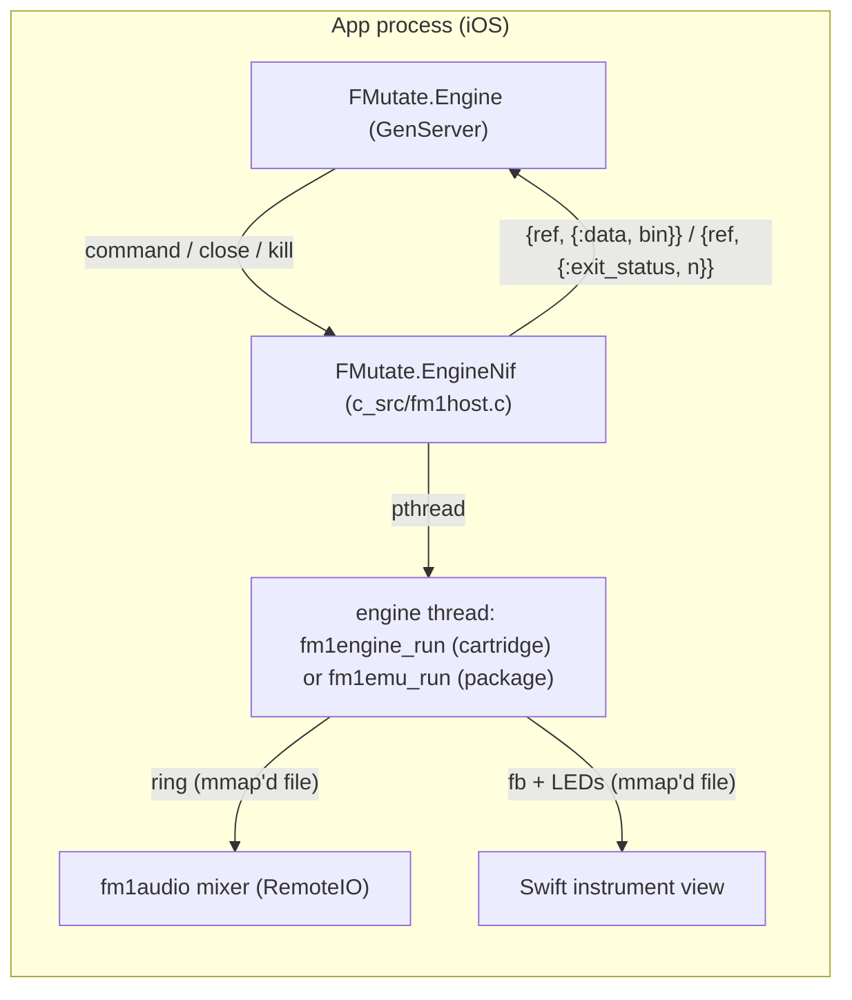

# FMutate on iOS

Status: accepted, phase 1 (design and feasibility). Branch `ios`.

FMutate is Android only: each firmware runs as its own OS process behind an Erlang Port, the emulator engine
compiles firmware to native code, audio is AAudio, and the instrument surface is Compose. iOS allows none of the
first two and has its own versions of the last two. This file decides how each part moves, measures what can't
be decided on paper (the emulator without its JIT), and lists what stays Android only.

Everything not named here stays as it is: the Elixir app (instances, library, layouts, editor, MIDI mapping,
distribution), the engine protocol (`docs/engine_protocol.md`: messages, ring, `.fb`, pacing, panel edges,
STATUS, the watchdog's timeouts), the mixer's algorithm and the firmwares' code.

## 1. Engines run in the app process

iOS apps can't `fork`/`exec`, so there is no engine process. Each engine runs on a thread of the app, behind the
same messages:

- **One engine code base, two hosts.** `native/engine/fm1engine.c` and `native/emu` become libraries with one
  entry each (`fm1engine_run`, `fm1emu_run`) taking the cartridge or package, the shm prefix, the flash file, the
  fill, and an I/O block: an input file descriptor carrying the same `{packet, 2}` stream as stdin does today, a
  send callback for READY / STATUS / FLASH_SAVED, and an abandon flag. The Android and host executables are a
  `main` that passes stdin and a stdout writer, so their behaviour doesn't change. Every `exit()` in the engines
  becomes a return with the same code (2 for an error, 3 for a halted package, 0 after the flash is saved), since
  an `exit()` on a thread would end the app.
- **The transport** is `FMutate.EngineNif` (static NIF `fm1host`, iOS only). `start(ref, kind, args)` makes a
  pipe, starts the engine thread on its read end and returns a handle; `command/2` writes framed messages into the
  pipe (`Port.command`); `close/1` closes the write end, which the engine sees as EOF exactly as a closed port
  (it saves the flash and returns 0); `kill/1` abandons the thread. Messages to the owner are
  `{ref, {:data, binary}}` and `{ref, {:exit_status, code}}`, the shapes a Port sends, so `FMutate.Engine` keeps
  its state machine and only chooses the transport: Port on Android and the host, NIF on iOS.
- **Shared memory stays.** The ring and the `.fb` file are already files mapped with `mmap`; inside one process
  they work unchanged (the engine thread, the mixer and the Swift view each map the same file). They move from
  `Documents/run` to the app's `tmp/` on iOS (Documents is backed up to iCloud). No protocol change.
- **Native cartridges are linked in.** No `dlopen` of a cartridge: iOS apps link their code statically. Each
  cartridge is compiled once per iOS target as today (`live.c` with the firmware's own sources included), then
  `ld -r` keeps one exported symbol, the cartridge's table (`fm1c_<id>`), and makes every other symbol local, so
  OberVave's and Shine On's `app_main`, `fb` and the rest don't clash; it also renames the cartridge's data and
  BSS sections to its own (`__DATA,__<id>_d` / `__<id>_b`). The firmwares mark a few buffers
  `__attribute__((section(".pool")))`, an ELF name that Mach-O rejects; the iOS build defines the attribute away
  (`-D'section(x)='`), so they land in ordinary BSS. Checked by hand: OberVave compiles for `arm64-apple-ios15`
  (warnings only: `sem_init`), and `ld -r -exported_symbol _fm1c_init -rename_section …` leaves that one global
  symbol and moves its data (732 bytes) and BSS (663 KB) into sections of their own.
- **A cartridge boots fresh every time.** In a process a new engine gets fresh globals; in-process the cartridge's
  globals are reused, so before each boot the host restores them: its data section is copied back from a
  snapshot taken before the first boot, its BSS is zeroed (the section bounds come from the linker's
  `section$start$__DATA$__<id>_d` symbols). The firmware's main loop runs as a coroutine on a thread of its own
  (`live.c`); to end it, `platform_poll` gets a quit flag and leaves the loop with `longjmp` back to the thread's
  start, which is safe because the loop is parked there whenever the engine isn't running it. POSIX unnamed
  semaphores don't exist on Darwin (`sem_init` fails with ENOSYS), so `live.c` uses dispatch semaphores there.
- **One live engine per cartridge.** Two engines of the same cartridge would share its globals. A switch between
  two firmwares overlaps them as on Android (different cartridges, different globals); a start of a cartridge
  whose previous engine is still stopping waits for it (up to the stop grace), and fails with `:busy` after that.
  The emulator keeps all its state in its own objects, so any number of package engines can run.
- **Threads.** Engine threads run at `QOS_CLASS_USER_INTERACTIVE` (they render ahead of the audio clock, 1024–3840
  frames), with an 8 MB stack for the emulator and 1 MB for a cartridge's firmware loop (the hardware's stack is
  far smaller).

### Crash, hang and quarantine without a process

What a process gave for free, and what replaces it:

| Event | Android (process) | iOS (thread) |
|---|---|---|
| Engine stops | port closed: flash saved, exit 0 | pipe closed: flash saved, `fm1emu_run`/`fm1engine_run` return 0, `{:exit_status, 0}` |
| Package halts, bad package | exit 3 / 2 | the same codes, returned |
| Emulator code panics | the process dies (signal) | `catch_unwind` around the engine thread: exit 134, the app lives |
| Firmware hang (native cartridge's loop never yields) | no STATUS for 1 s: kill -9, restart | no STATUS for 1 s: `kill/1` abandons the thread (`{:exit_status, 137}` at once, as kill -9); the thread can't be stopped, so its QoS drops to background and its cartridge stays `:busy` until the app restarts ("Restart the app to run <firmware> again"); any other firmware runs |
| Emulator firmware hang | the emulated CPU keeps running: STATUS continues, stale halves show starving | the same |
| Native cartridge crash (SIGSEGV in firmware code) | the process dies, restart | **the app dies**: no recovery on the thread. A fatal-signal handler (SIGSEGV, SIGBUS, SIGILL, SIGFPE, SIGTRAP, SIGABRT; chained, async-signal-safe: one `write` to a file opened beforehand, then the previous handler) records which firmware ran. At the next launch the instance counts it as a failure |
| Quarantine | dies twice within a minute | a firmware that ended the app twice with less than 60 s of clean running in between is quarantined at the next launch (safe mode, "Run anyway"); a failure of a running engine that the app survives (exit codes above) counts as on Android |
| Debug crash / hang / kill9 | SIGSEGV / spin / kill -9 | simulated: crash ends the engine thread as SIGSEGV would (exit 139, no flash save), hang spins until killed (then exits), kill9 abandons; they exercise the same restart and quarantine paths |

Recovering from a firmware's SIGSEGV on its thread (a signal handler or Mach exception handler that jumps out and
restarts it) is rejected: by then the firmware may have written anywhere in the process, including the BEAM's
heap. The two bundled cartridges are the firmwares' own release code; a crash there is rare, and the marker keeps
it from becoming a crash loop at every launch.

## 2. The emulator interprets on iOS

fm1-emu compiles firmware to native code (its JIT) on arm64 macOS, Linux and Android. A JIT needs writable and
executable memory (`MAP_JIT`), which iOS grants only with the `dynamic-codesigning` entitlement (Apple's own
apps; in the EU, also browser apps with their own engine), not to an app like this on the App Store or TestFlight.
So the emulator interprets on iOS. fm1-core already
builds without the JIT for any other OS (`crates/fm1-core/build.rs` sets `native_jit` only for macOS, Linux,
Android and Windows): `cargo check --target aarch64-apple-ios` of `native/emu` at the pinned fm1-emu passes with
the interpreter alone and no change to fm1-emu. The iOS binary has no JIT code in it at all.

### Measured: the interpreter on the Mac

`libfm1emu.so --bench <package> 8 7 11 14` (8 s emulated, a C major chord held from the second second; the
"held" speed below), Apple M4 Pro, macOS, host build at fm1-emu `42c7fef`, one run each. JIT = default;
interpreted = `FM1_NO_JIT=1`; lower clocks = `FM1_MHZ` (the emulated CPU clock, op `0x08`). "stale" = DMA halves
the firmware didn't refill (its audio starving), shown when non-zero. Packages: the FM-1 Firmware Hub's current
ones on 2026-11-13.

| Package | JIT 240 MHz | interp. 240 | 180 | 120 | 80 | A15 est. 240 | A15 est. 120 | A15: highest clock ≥ 1.0x |
|---|---|---|---|---|---|---|---|---|
| OberVave 3.5.2 | 6.51x | 1.02x | 1.31x | 1.96x | 2.73x (356 stale) | 0.59x | 1.14x | 120 MHz (1.14x) |
| Shine On 3.5 | 6.90x | 1.04x | 1.31x | 2.02x | 2.77x (281 stale) | 0.60x | 1.17x | 120 MHz (1.17x) |
| Dinghy 0.5 | 6.75x | 0.79x | 1.03x | 1.57x | 2.38x | 0.46x | 0.91x | 80 MHz (1.38x) |
| AMB 1.3.2 | 5.27x | 0.99x | 1.29x | 1.99x | 3.05x (10 stale) | 0.57x | 1.15x | 120 MHz (1.15x) |
| ZEN 1.2 | 5.91x | 0.98x | 1.38x | 2.04x | 2.98x | 0.57x | 1.18x | 120 MHz (1.18x) |
| GR!MM 2.0.2 | 6.51x | 0.80x | 1.09x | 1.69x | 2.66x | 0.46x | 0.98x | 80 MHz (1.54x) |
| Mutable 2.1 | 5.98x | 0.96x | 1.38x | 2.06x | 3.01x | 0.56x | 1.19x | 120 MHz (1.19x) |
| FMini 2.5.12 | 7.61x | 2.37x | 2.09x | 2.78x | 3.70x | 1.37x | 1.61x | 240 MHz (1.37x) |
| Felucca 1.8.2 | 6.33x | 0.90x | 1.19x | 1.76x | 2.52x | 0.52x | 1.02x | 120 MHz (1.02x) |
| Sloop 2.8.5 | 5.41x | 0.90x | 1.17x | 1.70x | 2.59x | 0.52x | 0.99x | 80 MHz (1.50x) |
| JIANT V10.7.23 | 4.31x | 0.95x | 1.24x | 1.80x | 2.53x | 0.55x | 1.04x | 120 MHz (1.04x) |
| Frasil 3.3 | 5.01x | 0.96x | 1.36x | 1.99x | 2.85x | 0.56x | 1.15x | 120 MHz (1.15x) |
| Skiff 2.6 | 4.67x | 0.88x | 1.22x | 1.75x | 2.53x (silent) | 0.51x | 1.01x | 120 MHz (1.01x) |
| Clipper 1.3.1 | 4.24x | 0.71x | 0.93x | 1.27x | 1.82x | 0.41x | 0.74x | 80 MHz (1.06x) |
| Melodee 1.6.1 | 2.87x | 0.68x | 0.86x | 1.18x | 1.56x | 0.39x | 0.68x | none |

The interpreter is 4–7 times slower than the JIT and, on one of the fastest single cores there is, runs most
packages at about real time at the FM-1's 240 MHz.

**The iPhone SE (3rd generation), estimated.** Its A15 big core scores 2140–2400 in Geekbench 6 single-core
(published results) against 3900–4000 for an M4 Pro: about 0.58 of it, which is the factor in the "A15 est."
columns. On that estimate **no package but FMini runs in real time at 240 MHz on the iPhone SE (0.39–0.60x)**;
with the emulated CPU clock that `FMutate.Instance.Health` already lowers (240 → 180 → 120 → 80 MHz), most reach
1.0–1.2x at 120 MHz, a thin margin for a 95 % rule on a two-big-core phone that also runs the audio callback, the
UI and the BEAM; Dinghy, GR!MM, Sloop and Clipper need 80 MHz (Sloop and OberVave starve or go silent there),
and Melodee doesn't run in real time at any clock. The estimate is replaced by measurements on the phone in
phase 2 (the same `--bench`, run in the app).

**Decision.** The emulator ships on iOS interpreted, behind the same Health logic: it lowers the emulated clock
and says "This phone can't run it in real time" where nothing is left. **The native cartridges are the iOS
path** for real-time play: they don't emulate the CPU (on the Moto G Power 2021's Snapdragon 662 OberVave took
16–34 % of one core; an A15 core is several times faster). If the phone confirms the estimate, the options, in
order of cost:

1. More native cartridges: firmwares with published source in the Dinghy/zvenson family build with `live.c`
   as OberVave and Shine On do.
2. A faster interpreter in fm1-emu (upstream work: dispatch, block fusion, idle detection); unknown gain.
3. Packages only on faster iPhones (published Geekbench 6 single-core: A17 Pro ~1.25x an A15, A18 Pro ~1.5x):
   mark packages "too slow on this iPhone" up front from a short bench at first run.

No JIT workaround (debugger-attached JIT, `get-task-allow` builds) is considered: none survives App Store or
TestFlight distribution.

## 3. Audio: RemoteIO behind the same mixer

`c_src/fm1audio.c` keeps its mixer (slots, ramps, the 44.1 kHz clock written back into each ring, the
resampler, the soft clip, underrun counts) and gets an Apple backend beside AAudio:

- **Output**: an `AudioUnit` of subtype `kAudioUnitSubType_RemoteIO`, int16 interleaved stereo at the
  hardware's rate (48 kHz on iPhones), render callback = the AAudio data callback's body. Same NIF functions and
  stats keys, so `FMutate.Audio` doesn't change.
- **Session** (`AVAudioSession`, an Objective-C API, in a small Swift file exporting C functions with
  `@_cdecl`): category `.playback` (plays with the ring switch on silent, keeps playing in the background),
  preferred IO buffer 5 ms (256 frames at 48 kHz), activated on `start`. Interruptions (a call, Siri) stop the
  unit and restart it when they end; a route change (headphones, AirPlay, USB) re-reads the rate and restarts the
  unit; a media-services reset rebuilds it. These replace AAudio's disconnect-and-reopen thread.
- **Stats**: `latency_ms` = `AVAudioSession.outputLatency` + `IOBufferDuration` (the AAudio timestamp method has
  no iOS equivalent); `burst` = frames per render callback; `xruns` = gaps in the callback's `mSampleTime` (iOS
  has no xrun counter); `sharing` is `:shared`; `device_id` 0 (the route is named from the session instead of
  `fm1io`).

## 4. The instrument surface in Swift

The surface (`InstrumentView.kt`, `Layout.kt`, `FirmwareShm.kt`, `MotionControl.kt`, `EditMode.kt`,
`Opling.kt`: ~3 400 lines of Kotlin) is ported to Swift, registered with Mob's iOS registry under the same name
(`MobNativeViewRegistry.shared.register("FMutate_InstrumentView") { props, send in … }`, called from FMutate's
`AppDelegate.m`). Mob's plugin bootstrap can't be used for it: it drops the view's `send`.

- A `UIView` subclass (UIKit, not SwiftUI views) inside a `UIViewRepresentable`: per-touch tracking with
  `UITouch` identity gives each finger its control, as the Kotlin pointer loop does, and `touchesCancelled`
  releases what the system took away (the Kotlin "stale fingers" rule).
- Drawing on layers that redraw only when their content changes (controls, held keys, firmware screen, creature,
  overlay), as in Kotlin; the firmware screen is the mapped `.fb` read on a `CADisplayLink`, converted RGB565 →
  `CGImage` when `seq` changes, scaled nearest-neighbour then smoothed as `ScreenScaler` does.
- The same props and events (JSON payloads `in`, `diag`, `menu`, `page`, `edit`, …), so `FMutate.InstrumentView`,
  `FMutate.Editor` and the screens don't change. Motion controls read CoreMotion in Swift, as Kotlin reads
  `SensorManager`, never through the BEAM.
- Layout fitting keeps `Layout.kt`'s rule in points. The iPhone SE is 667 × 375 pt in landscape: the classic
  14 × 6 layout's cells would be 36 pt wide, under the 40 pt squeeze limit, so its cells move onto the phone's
  own 11 × 6 grid (rule 3), where it may not fit; checked on the phone in phase 3. The 28 pt side gutters are
  for Android's back gesture; iOS may need less.

The Mob screens (library, I/O, editor sheets) are `~MOB` and render on iOS through Mob's SwiftUI renderer as
they are.

## 5. Plugins and Mob

| | iOS |
|---|---|
| mob_midi (pinned 052b775) | has an iOS NIF (CoreMIDI): devices, ports, timestamps, `open_virtual` (a `MIDISourceCreate` + `MIDIDestinationCreate` pair, visible to other apps as "FMutate A"). USB class-compliant devices work through CoreMIDI. Bluetooth MIDI on iOS is paired by the system (CoreAudioKit's `CABTMIDICentralViewController`), not by a scan: "Scan Bluetooth" opens that panel or is hidden. The consolidate-0.3 PR (#6) is Android-first; the pin stays until it has iOS parity |
| mob_background | its iOS keep-alive is a silent `AVAudioEngine`. FMutate's own RemoteIO output already keeps the app running in the background (`UIBackgroundModes` `audio`) while a firmware plays, and a second audio engine would only cost power, so `FMutate.Background` does nothing on iOS |
| mob_sensors | has an iOS NIF (CoreMotion, proximity): `MobSensors.list/0` works for the editor's list. `NSMotionUsageDescription` comes from its manifest |
| fm1io (audio output list, JNI) | Android only (`archs: [:android]` already). iOS names the session's route; choosing an output is the system's route picker (`AVRoutePickerView`) |
| fm1audio | `archs: [:all]`; AAudio or RemoteIO by platform (above) |
| fm1host (new) | iOS only; links `native/build/ios/<target>/libfm1native.a` (engine core, cartridges, emulator) through `:extra_static_libs` |

The iOS app shell (`ios/`: `AppDelegate.m`, `Info.plist`, `build.zig`, `build_device.zig`) comes from
`mix mob.adopt.native.ios` (mob_new's templates); FMutate's Swift files are listed in `mob.exs`
`project_swift_sources`. `native/build_ios.sh` builds the archive per target (simulator, device): the engine core
and cartridges with `xcrun clang`, the emulator with `cargo build --target aarch64-apple-ios(-sim)` as a static
library, merged with `libtool -static`.

## 6. Android only, or not possible on iOS

- **Process isolation of firmwares**: gone (above). A native cartridge crash ends the app.
- **The JIT**: interpreter only (above).
- **32-bit ARM, x86-64 builds**: iOS is arm64 only (the simulator on Apple silicon is arm64 too).
- **Choosing the audio output**: the system route picker instead of FMutate's list.
- **Bluetooth MIDI scan**: system pairing panel instead.
- **Foreground-service notification**: iOS has none; the app plays in the background while its audio session is
  active, and iOS may still end it under memory pressure.
- **Sibling apps on the same phone** (`docs/design/protocol.md`): the Android handover of the distribution
  cookie through a content provider checked by signing key has no iOS equivalent. Pairing (the QR flow being
  added on branch `pairing`) has to work on iOS too; sibling apps of the same developer team could share the
  cookie through an App Group container. iOS also suspends background apps that aren't playing audio, so a
  sibling app talking to FMutate over distribution in the background is limited to while FMutate plays. Not
  designed here.
- **Installing**: no APK sideloading; a development build is installed with Xcode's tools (`mix mob.deploy`),
  anything wider needs TestFlight or the App Store (below).

## 7. Licence and distribution (noted, not solved)

- FMutate is GPL-3 and compiles in GPL-3 firmwares (OberVave, Shine On by zvenson). The App Store's terms of use
  add restrictions the GPL forbids adding (the FSF's position; VLC was pulled in 2011 over it). An App Store or
  TestFlight build needs the copyright holders' permission (FMutate's authors and zvenson) or a licence exception;
  a development build on Kevin's own phone doesn't distribute anything.
- fm1-emu is MIT: no issue.
- Downloaded firmware packages are code run by an emulator. Guideline 4.7 allows emulators since 2024, and 2.5.2
  (no downloading of executable code) is what an App Review would weigh against the library's Hub downloads;
  each firmware's own licence (several binary-only) applies to its distribution, which FMutate doesn't do (the
  player downloads from the authors' links).
- Signing: development builds use Kevin's team (as choir_coach's `ios_team_id`); a bundle id
  (`com.genericjam.fmutate`) needs registering for the device build.

## 8. Phases

1. This file and the measurements (above).
2. iOS builds: engine and emulator libraries with the in-process host, fm1audio's RemoteIO backend, the Elixir
   transport switch, the `ios/` shell, plugins compiling; simulator, then the iPhone SE: a native cartridge
   boots, its screen shows (a minimal Swift view of the `.fb` first), keys play; latency and underruns measured;
   the emulator benched on the phone.
3. Parity: the Swift instrument surface (layouts, multitouch, LEDs, edit mode, the Opling, motion), the library,
   MIDI (virtual port, devices), background audio, the iOS-specific items above.
